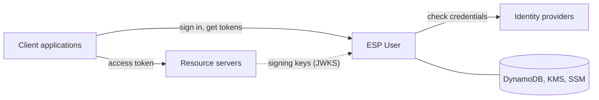

# Espressif User Management

ESP User is the OAuth 2.1 and OpenID Connect authorization server of an ESP RainMaker Neo deployment. Every token an end user's application holds is issued here. A person can sign in with a password, a one-time code, or an external OpenID Connect provider; whichever they use, the application receives ESP User's own tokens and never the provider's.

Admins sign in separately, directly against the admin Cognito user pool ([admin_auth.md](docs/specs/admin_auth.md)).

## Capabilities

| Capability | Specification |
| --- | --- |
| Authorization Code Grant with PKCE (RFC 6749, RFC 7636) | [authorize-code-flow.md](docs/specs/authorize-code-flow.md) |
| Refresh Token Rotation and Reuse Detection (RFC 6749, RFC 9700) | [auth-flows.md](docs/specs/auth-flows.md) |
| Client Credentials Grant (RFC 6749) | [auth-flows.md](docs/specs/auth-flows.md) |
| Token Revocation (RFC 7009) | [auth-flows.md](docs/specs/auth-flows.md) |
| UserInfo Endpoint (OpenID Connect Core 1.0) | [auth-flows.md](docs/specs/auth-flows.md) |
| Discovery and Signing Keys (OpenID Connect Discovery 1.0, RFC 8414, RFC 7517) | [oidc-oauth2.md](docs/specs/oidc-oauth2.md) |
| Audience-Restricted Access Tokens (RFC 8707) | [resource-indicators.md](docs/specs/resource-indicators.md) |
| Single Sign-On Sessions (OpenID Connect Core 1.0) | [sso-sessions.md](docs/specs/sso-sessions.md) |
| RP-Initiated Logout (OpenID Connect RP-Initiated Logout 1.0) | [sso-sessions.md](docs/specs/sso-sessions.md) |
| Offline Access (OpenID Connect Core 1.0) | [sso-sessions.md](docs/specs/sso-sessions.md) |
| User Consent for Third-Party Clients | [authorize-code-flow.md](docs/specs/authorize-code-flow.md) |
| Brokered Sign-In with External OpenID Connect Providers | [federation.md](docs/specs/federation.md), [external-provider.md](docs/specs/external-provider.md) |
| OAuth Client Registry | [admin-clients.md](docs/specs/admin-clients.md) |
| Native Password API | [legacy-user-auth.md](docs/specs/legacy-user-auth.md) |

## Architecture

ESP User runs as Go Lambda functions behind API Gateway. DynamoDB holds every piece of state, KMS holds the token-signing key, and SSM holds the published key set.

- **One issuer for every sign-in.** ESP User verifies the upstream identity server-side and issues its own tokens, so upstream tokens never reach a client ([federation.md](docs/specs/federation.md)).
- **One API per access token.** Each access token names exactly one resource server in `aud`, so a leaked token opens only that API ([resource-indicators.md](docs/specs/resource-indicators.md)).
- **Refresh tokens rotate.** Every refresh returns a new refresh token, and presenting a spent one ends that login ([auth-flows.md](docs/specs/auth-flows.md)).
- **The signing key never leaves KMS.** Resource servers verify tokens locally against the published key set and never call ESP User per request ([oidc-oauth2.md](docs/specs/oidc-oauth2.md)).
- **Sign-in pages are served by ESP User itself,** from the same origin as the API. They keep an opaque session cookie for single sign-on and hand the application an authorization code, never a token ([sso-sessions.md](docs/specs/sso-sessions.md)).

## Tokens

| Token | Format | Issued to | Lifetime |
| --- | --- | --- | --- |
| Access token | JWT, RS256 | One resource server, named in `aud` | 1 hour |
| ID token | JWT, RS256 | The client application | 1 hour |
| Refresh token | Signed string, opaque to clients | The client application | 365 days, renewed on every use |

An access token authorizes API calls; an ID token only identifies the user to the client and is never sent to an API.

## Integrating

**A client application** is registered by an admin in the client registry ([admin-clients.md](docs/specs/admin-clients.md)) with its exact redirect URIs and the APIs it may call. It reads `/.well-known/openid-configuration`, signs the user in with the authorization code grant and PKCE, and names the API it needs with the `resource` parameter.

**A resource server** verifies every access token against ESP User's published keys, issuer and expiry, and accepts it only when `aud` names that server. The full checklist is in [resource-indicators.md](docs/specs/resource-indicators.md#what-a-resource-server-must-check).

The HTTP contract for every endpoint is [User_Api_Swagger.yaml](../../docs/api/User_Api_Swagger.yaml).

## Code layout

| Path | Responsibility |
| --- | --- |
| `handlers/` | One Lambda per directory: `authorize`, `token`, `revoke`, `userinfo`, `sessions`, `well_known`, `publish_discovery`, `user_auth`, `user_common`, `clients`, `espuser_admin_creds` |
| `auth/` | Sign-in completion, token minting and verification, resource selection |
| `refreshtoken/` | Refresh-token issue, rotation, reuse detection and revocation |
| `session/` | The authorization server's browser session |
| `idp/` | External identity providers: provider registry and the brokered sign-in |
| `legacyauth/` | The native password API |
| `clients/` | OAuth client registry service |
| `scope/` | Scope parsing and checks |
| `sender/` | Sender address resolution for outgoing email |
| `db/` | One package per DynamoDB table |
| `hosted-ui/` | The sign-in, consent and sign-out pages, compiled into the `authorize` Lambda |
| `stacks/` | CDK stacks |

## Specifications

- **Protocol:** [oidc-oauth2.md](docs/specs/oidc-oauth2.md), [authorize-code-flow.md](docs/specs/authorize-code-flow.md), [auth-flows.md](docs/specs/auth-flows.md), [resource-indicators.md](docs/specs/resource-indicators.md)
- **Sessions and sign-out:** [sso-sessions.md](docs/specs/sso-sessions.md), [hosted-ui.md](docs/specs/hosted-ui.md)
- **Identity providers:** [federation.md](docs/specs/federation.md), [external-provider.md](docs/specs/external-provider.md), [legacy-user-auth.md](docs/specs/legacy-user-auth.md), [email-sender.md](docs/specs/email-sender.md)
- **Administration:** [admin-clients.md](docs/specs/admin-clients.md), [admin_auth.md](docs/specs/admin_auth.md)

How ESP RainMaker Neo exchanges an ESP User access token for AWS credentials is in [user_auth.md](../../docs/en/specs/user_auth.md).
