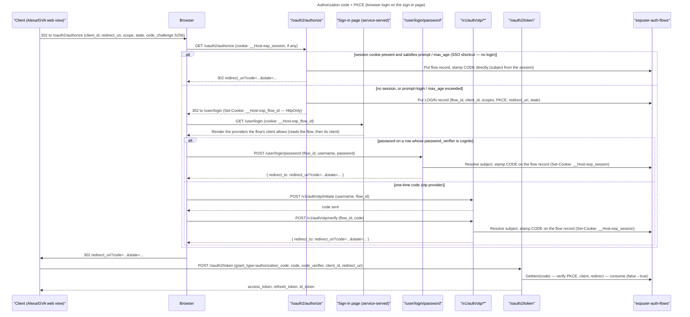

# Authorization Flow

> Two behaviours of this endpoint have specs of their own: whether the login leg can be
> skipped for a browser that already signed in is [sso-sessions.md](sso-sessions.md), and
> what the `resource` parameter does to a token's audience is
> [resource-indicators.md](resource-indicators.md).

## What this is

The standard OAuth 2.1 / OIDC browser login: a client (e.g. the Alexa or Google Voice Assistant account-linking web view) redirects the user to `GET /oauth2/authorize`, the user signs in on a **service-served sign-in page** (a password, a one-time code, or a button to a provider's own page), and we hand the client back a single-use **authorization code** at its `redirect_uri`. The client then exchanges that code (with its PKCE verifier) at `POST /oauth2/token` for the token set.

This is the interactive counterpart to [direct-token OTP](auth-flows.md) and the [native password APIs](legacy-user-auth.md): the person signs in with a password, a one-time code or a provider's own page, and the browser only ever carries an opaque flow id and the final code — never tokens or claims.

> Alexa account-linking runs here: the voice platform is a browser authorization-code + PKCE client of this surface. The access token issued here is what an end user later exchanges for AWS/IoT credentials — see [user_auth.md](../user_auth.md).

## Why it is needed

- Alexa/GVA account linking is a **browser redirect** flow: the voice platform opens our authorize URL, the user authenticates, and the platform receives a code at its registered redirect. It cannot use the native direct-token path (no app to hold a `flow_id`, must be OAuth-standard).
- The authorization code + PKCE handshake keeps tokens out of the browser URL and binds the code to the client that started the flow (RFC 7636), which direct-token mode sidesteps.

## Scope of this slice

**In:** `GET /oauth2/authorize`, the service-served sign-in page (a password checked by the pool of a row whose `password_verifier` is `cognito`, a one-time code from an `otp` row, or a button to the own page of an `oidc` provider naming no `password_verifier`), single-use code issuance, and the `authorization_code` grant at `POST /oauth2/token`.

**In:** SSO sessions and silent re-auth — see [Single sign-on](#single-sign-on--the-session) below.

**Out (deferred):** per-client branding and the full S3+CloudFront branded SPA. Those are deferred features and are **not** built here. A first-party client skips consent, so its flow goes sign-in → code; any other client is asked about first (see [Consent](#consent--clients-we-do-not-ship)).

## Pre-requisites

- A registered client ([admin-clients.md](admin-clients.md)) with exact-match `redirect_uris`, `grant_types` including `authorization_code`, and `require_pkce=true` (forced for public clients).
- For a one-time code on the page, OTP delivery configured (SES/SNS) and the OTP endpoints deployed ([auth-flows.md](auth-flows.md)).
- The RS256 signing key and discovery/JWKS documents exist ([oidc-oauth2.md](oidc-oauth2.md)).

## Key Rules

1. **PKCE-S256 is required per the client's `require_pkce` policy** (forced `true` for public clients — RFC 9700 §2.1.1; optional for a confidential client registered with `require_pkce=false`). When required and a `code_challenge` is absent, `/oauth2/authorize` returns `invalid_request` (RFC 7636 §4.4.1); a challenge that is present MUST use `S256`. Downgrade protection at `/oauth2/token` (RFC 9700 §2.1.1): a code bound to a challenge MUST be redeemed with a matching `code_verifier`, and a code issued without one MUST be redeemed without a verifier.
2. **Exact `redirect_uri` match.** The `redirect_uri` must string-equal one of the client's registered URIs — no wildcards, no prefix/substring. A mismatch is rejected **on our error page**, never redirected (an unvalidated redirect is an open redirector).
3. **The browser carries only the opaque flow id and the final code.** Flow state (client, scopes, PKCE, redirect) lives in the [espuser-auth-flows](#espuser-auth-flows) record; the browser holds the flow id in a short-lived `HttpOnly` `Secure` `SameSite=Lax` cookie. (`HttpOnly` = unreadable by JavaScript, so `document.cookie` can't leak it; `Secure` = sent only over HTTPS; `SameSite=Lax` = not sent on cross-site requests, blunting CSRF.)
4. **The authorization code is single-use.** Redemption deletes the flow record under an item-exists condition, so a concurrent or replayed second exchange fails atomically and is denied with `invalid_grant` (RFC 6749 §4.1.2 / §10.5).
5. **The redeeming client must match the issuing client.** `/oauth2/token` checks that `client_id` and `redirect_uri` on the exchange equal those stamped on the code's flow record; a mismatch is `invalid_grant`.
6. **Codes are short-lived** (TTL ≤ 60s recommended, ≤ 10 min hard cap) via the flow record's `expires_on` TTL.
7. **`state` is echoed to the client's redirect** for CSRF protection. `nonce` is not accepted (see Open items).
8. **No tokens in URLs** beyond the spec-mandated `code` on the authorization redirect.
9. **A client we do not ship gets no code until the person allows it.** See [Consent](#consent--clients-we-do-not-ship).

## The flow, end to end



## `GET /oauth2/authorize`

Starts the flow. Validates the request, writes a `LOGIN` flow record, and redirects the browser to the sign-in page with the flow-id cookie set.

**Query parameters**:

| Param | Required | Notes |
| --- | --- | --- |
| `response_type` | yes | Must be `code`. Anything else → `unsupported_response_type`. |
| `client_id` | yes | Must be a registered client. |
| `redirect_uri` | yes | Exact match against the client's registered URIs. |
| `scope` | no | Optional (RFC 6749 §4.1.1); space-delimited; include `openid` for an id_token. Each requested scope must be within the client's allowed scopes. `offline_access` asks for a refresh token that no sign-out ends, and always asks for consent (see [Consent](#consent--clients-we-do-not-ship)). |
| `state` | recommended | Opaque; echoed back on the redirect (client CSRF token). |
| `code_challenge` | conditional | PKCE (RFC 7636). Required when the client is registered with `require_pkce` (always true for public clients — RFC 9700 §2.1.1); optional otherwise. |
| `code_challenge_method` | conditional | Must be `S256` when a `code_challenge` is present. |
| `resource` | no | RFC 8707: the APIs this sign-in covers, repeatable. Each must be one of the client's `allowed_resources`; omitted, the sign-in covers the client's `default_resource`, and a client without one is refused. Either refusal redirects with `invalid_target`. Remembered on the flow and by the refresh family; each access token is for one of them ([resource-indicators.md](resource-indicators.md)). |
| `prompt` | no | OIDC Core §3.1.2.1: `none` answers silently from the session, or redirects with `login_required` (no session) or `consent_required` (a client that needs consent); `login` and `select_account` always re-authenticate; `consent` keeps the session and always shows the consent screen. `none` with any other value redirects with `invalid_request`. |
| `max_age` | no | Maximum acceptable age (seconds) of the session's `auth_time`. An older session is not used. |
| `id_token_hint` | no | A previously issued ID token naming the expected subject. A session belonging to anyone else, or an unverifiable hint, is not used — the flow never switches to the hinted user. |

**Process**:
1. Validate `response_type=code` and that `client_id` is a registered client. A structural failure here renders the **service error page** (we cannot safely redirect yet).
2. Validate `redirect_uri` is an exact registered URI for the client. Mismatch → error page (never redirect).
3. PKCE: if the client's `require_pkce` is set, a `code_challenge` MUST be present (RFC 7636 §4.4.1, else `invalid_request`); if a challenge is present its method MUST be `S256`.
4. Validate requested `scope` ⊆ client's allowed scopes (the `scopes` list on its row, `offline_access` included only when listed). An over-broad scope → redirect the client with `invalid_scope` (redirect is now safe, the URI is validated).
5. Write a `LOGIN` record to [espuser-auth-flows](#espuser-auth-flows): fresh `flow_id`, `client_id`, `requested_scope`, `code_challenge`, `code_challenge_method`, `redirect_uri`, `state`, TTL'd `expires_on`.
5. Set the `flow_id` in a short-lived `HttpOnly` `Secure` `SameSite=Lax` cookie and `302` to `/user/login`, which carries only `login_hint` and `idp`; or, when the only enabled provider is an `oidc` row, straight to `/user/login/federation/start` for it ([federation.md](federation.md#provider-selection-at-oauth2authorize)).

**Errors** — pre-redirect failures (steps 1–2) render the error page with an RFC 6749 §5.2 error body; post-validation failures (step 3+) redirect to `redirect_uri?error=<code>&state=<state>`.

After validation and the flow write, the browser's session is consulted before choosing the login surface — see the next section. A live session that satisfies `prompt`/`max_age`/`id_token_hint` issues the code immediately; otherwise the login redirect proceeds exactly as above.

## Single sign-on — the session

The authorization server keeps its own browser session (`__Host-esp_session`), so a person who authenticated once is not asked again when a second client starts a login, and `prompt=none` can be answered. [sso-sessions.md](sso-sessions.md) owns the session model: lifetimes, the `espuser-sessions` row, re-authentication, and sign-out.

What this flow relies on:

- **Consulted** at `/oauth2/authorize`, after request validation: a live session that satisfies `prompt`/`max_age`/`id_token_hint` issues the code immediately. `prompt=none` with no usable session redirects with `error=login_required`; `prompt=login` is always honoured.
- **Established** on every first-party login (the sign-in page's password form, OTP, federation, the native password API); the flow's `sid` is stamped at code issuance and carried onto the refresh family.
- **`auth_time` is the session's**, stamped on the flow at code issuance and on the refresh family, so an ID token from the shortcut or a refresh names the original authentication, never the mint time.

## Consent — clients we do not ship

A client whose row has `first_party` is one we ship (the RainMaker app, the ESP Account dashboard); every other client — a voice assistant, an MCP client, another company's app — is asked about on every interactive sign-in. Without this, anyone holding a session hands a code to any registered client that redirects them, with no click. RFC 6749 §10.2 and RFC 8252 §8.6 forbid processing such requests automatically without the person's interaction, and RFC 9700 §4.11.2 allows an automatic redirect only to a redirection URI the authorization server trusts.

| | First-party client | Any other client |
|---|---|---|
| Sign-in (password, code, Google, or an existing session) | code issued | sign-in held; browser sent to `/user/login/consent` |
| `prompt=consent` | sign-in held | sign-in held |
| `prompt=none` with a session | code issued | `error=consent_required` |
| `offline_access` requested | sign-in held | sign-in held |

- `offline_access` always asks, whoever the client is: OIDC Core 1.0 §11 requires consent before returning a refresh token that works while the person is away. With `prompt=none` it is `error=consent_required`.
- `/oauth2/authorize` makes the decision once, from the client, `prompt` and `scope` it has just validated, and stores it on the flow as `skip_consent`; every sign-in that finishes the flow (password, code, federation, the session shortcut) reads it from there. An absent `skip_consent` means the person is asked.
- **Held** means the flow records the person (`subject`, `sid`, `auth_time`, `granted_scope`) but no `code`, so nothing can be exchanged. The flow keeps its own expiry; an unanswered consent lapses with it.
- `GET /user/login/consent` draws the screen from the held flow: the client's name (its `client_id` when it has none) and `logo_uri` (a generic app icon when it has none), the signed-in account, and the requested scopes.
- `POST /user/login/consent` with `{"decision":"allow","flow_id":…}` issues the code, but only to the browser session that signed in: the held flow outlives a sign-out by minutes, so the flow cookie alone does not allow it; `{"decision":"deny","flow_id":…}` deletes the flow and returns `error=access_denied` to the client (RFC 6749 §4.1.2.1). Both answer `{ "redirect_to" }` with `Cache-Control: no-store`; an Allow or Cancel with no sign-in waiting, a repeated one included, and an Allow from a browser without that session, answers `400 expired_flow`.
- The answer is bound to the browser by the `SameSite=Lax` flow cookie, so another site cannot post it, and the page carries `frame-ancestors 'none'`, so it cannot be framed to trick a click (RFC 9700 §4.16, RFC 6749 §10.13).
- An absent `first_party` means third-party, so a client registered without thought is asked rather than trusted.
- Nothing is remembered: there is no consents table, so a third-party client is asked on every sign-in.

## Sign-in page (service-served)

A small app served by the identity service from its own origin ([federation.md](federation.md#the-sign-in-app)) — **no** custom domain, **no** per-client branding, **no** CloudFront. `GET /user/login`:
1. Reads the flow from the `__Host-esp_flow_id` cookie, then the flow's client. A flow that expired draws the "Start again" error screen and no form; a flow whose row is gone, or no cookie at all, leaves nothing to restart, so its error screen has no "Start again".
2. Draws only the providers that client allows, under the client's registered name. Each provider's `method` is `password` (a form on this page, for an `oidc` row whose `password_verifier` is `cognito`) or `redirect` (a button to the provider's own page, for an `oidc` row naming none); a row naming a `password_verifier` it cannot call, or with no `client_id`, is left out; a one-time code is offered when an `otp` row is allowed.
3. A password goes to `POST /user/login/password` with `{ flow_id, provider?, username, password }`; a code goes to `POST /v1/auth/otp/verify` with `{ flow_id, code }`. Either returns `{ redirect_to }` with the session cookie, and the page navigates there: back to the client's `redirect_uri` with the `code`, or to the consent screen.

`POST /user/login/password` runs in this order, so nothing is spent on a request that cannot finish:
1. The flow cookie must be present and equal the body's `flow_id`, else `400 flow_replaced` (no cookie: `400 expired_flow`).
2. The pool is the named `provider`, which must be an enabled row whose `password_verifier` is `cognito` and that has a `client_id` (else `400 invalid_request`, `Unknown provider.`), or with none named the first such row by `provider_name`.
3. The flow is read (expired or missing: `400 expired_flow`), and then its client.
4. The client must allow that provider (`403 provider_not_allowed`); a client that cannot be read refuses. This is checked before the password reaches the pool.
5. Cognito `InitiateAuth`: `401 invalid_credentials` for a wrong password and an unknown account alike, `403 unconfirmed_account`, `403 new_password_required`, `403 password_reset_required`; a pool that fails rather than refuses (throttling, a missing app client, a wrong client secret, a network error) is `500 server_error`.
6. The account is found or created.
7. The sign-in is completed.

Every sign-in that establishes a session ends in one completion step: the password form, OTP (through the enterprise add-on's browser verify) and the federation callback. It establishes the session with the browser's user agent, IP address and prior session cookie, then issues the code or holds the sign-in for consent. `allowed_providers` is enforced before the credential is checked on the password and OTP paths, fails closed when the client cannot be read, and answers `provider_not_allowed`; the federation path keeps its gate at `/user/login/federation/start`, and the session shortcut its own check.

A failure of ours after the password was accepted is `500 server_error`, never an `invalid_credentials`. Success is `200 { "redirect_to" }`, where `redirect_to` is the client's `redirect_uri` with `code` and `state`, or `login/consent`, relative to `/user/login`; the response sets `__Host-esp_session`, carries `Cache-Control: no-store`, and never contains a token, which would step over the client's PKCE binding. Every response carrying `redirect_to` is `no-store`. Errors are `{ "error", "error_description" }`.

The page never mints a token, never sees signing keys, and never puts claims in the URL. Responses are `Cache-Control: no-store`.

> The OTP `initiate`/`verify`/`resend` contracts and the browser-vs-direct-token split are owned by [auth-flows.md](auth-flows.md); this spec does not redefine them. A browser `verify` stamps the flow's `subject`, transitions the `LOGIN` record to `CODE` (mints the `code`), and returns `{ redirect_to }`.

## `POST /oauth2/token` — `authorization_code` grant

Extends the existing token endpoint (which today serves `refresh_token`, [auth-flows.md](auth-flows.md#token-endpoint-post-oauth2token)) with the `authorization_code` grant.

**Client authentication** (both grants, RFC 6749 §3.2.1 → §2.3.1): HTTP Basic only. A confidential client MUST present `Authorization: Basic base64(client_id:secret)` — a bad/missing secret is `401 invalid_client`; a public client sends its `client_id` (in Basic or the form body) with no secret, and relies on PKCE (code) / rotation (refresh) instead. `client_secret_post` is not accepted (RFC 6749 §2.3.1 NOT RECOMMENDED). This mirrors [/oauth2/revoke](auth-flows.md#revoke-endpoint-post-oauth2revoke).

**Request** (form-encoded):
```
grant_type=authorization_code
code=<authorization code>
code_verifier=<PKCE verifier>   (required iff the code was bound to a challenge)
client_id=<client>
redirect_uri=<same redirect_uri used at authorize>
resource=<one of the sign-in's resources>   (optional)
```

**Process**:
1. Require `grant_type=authorization_code`, `code`, `client_id`, `redirect_uri`. Missing/malformed → `invalid_request`. (`code_verifier` is conditional — see step 4.)
2. Look up the `CODE` flow record by `code`. Unknown/expired/already-consumed → `invalid_grant` (a consumed code additionally burns the flow — reuse = theft).
3. Verify `client_id` and `redirect_uri` equal those stamped on the record; mismatch → `invalid_grant`.
4. Verify PKCE: `BASE64URL(SHA256(code_verifier)) == code_challenge`. Mismatch, or a verifier supplied for a code with no challenge (or vice-versa), → `invalid_grant` (RFC 9700 §2.1.1).
5. Pick the access token's one resource from the record's `resources`: the `resource` named, else the only one, else the client's default ([resource-indicators.md](resource-indicators.md)). A refusal → `invalid_target`, and the code stays unspent.
6. Consume the code (conditional `consumed = false → true`); a lost race → `invalid_grant`.
7. Mint the token set for the record's `subject` + `granted_scope`: RS256 access token, a fresh refresh-token family covering every resource of the sign-in, and an id_token when `openid` is in scope.

**Response** (`200`, `application/json`) — same shape as the refresh grant:
| field | example | notes |
|---|---|---|
| `access_token` | `eyJ...` |  |
| `token_type` | `Bearer` |  |
| `expires_in` | `3600` |  |
| `refresh_token` | `a1b2c3d4...` |  |
| `id_token` | `eyJ...` |  |
| `scope` | `openid email` |  |

**Errors** (RFC 6749 §5.2 error object):
- `400 invalid_request` — missing/malformed `code`, `code_verifier`, `client_id`, or `redirect_uri`.
- `400 invalid_grant` — unknown/expired/consumed code, client or redirect mismatch, or PKCE failure (uniform; no oracle).
- `400 invalid_target` — a `resource` the sign-in does not cover, two `resource` values, or several covered and no default among them.
- `400 unsupported_grant_type` — a `grant_type` this endpoint does not serve.

## espuser-auth-flows

The flow record threading a request from `/oauth2/authorize` through OTP login to the issued `code`. New table; add to `USER_TABLE_NAMES` / `USER_INDEX_NAMES`. `ManagedTable` via the GSI orchestrator like the other `espuser-*` tables. TTL'd; holds no long-lived PII.

**Keys**: `flow_id` (PK), `sk` (SK).

| Attribute | Type | Notes |
| --- | --- | --- |
| `flow_id` (PK) | String | Opaque; only ever in the short-lived session cookie, never a URL. |
| `sk` (SK) | String | `LOGIN` (→ `CODE` at code issuance). |
| `client_id` | String | Originating client. |
| `requested_scope` | List<String> | From the authorize request. |
| `redirect_uri` | String | Validated, exact-match. |
| `state` | String | Echoed on the redirect (client CSRF token). |
| `code_challenge` / `code_challenge_method` | String | PKCE (`S256`). |
| `resources` | List<String> | The RFC 8707 resources this sign-in covers; read at the code exchange and carried onto the refresh family. |
| `sid` | String | The browser session this login ran under; ties the refresh family to its parent session. |
| `skip_consent` | Bool | Set at `/oauth2/authorize` for a first-party client without `prompt=consent` or `offline_access`; absent means the person is asked. |
| `subject` | String | Resolved `user_id`, bound once at sign-in. A `subject` with no `code` is a sign-in held for consent. |
| `granted_scope` | List<String> | Stamped when the person is bound (= requested). |
| `code` | String | The single-use authorization code; minted when the record becomes `CODE`. Looked up by a `by-code` GSI. |
| `consumed` | Bool | Single-use guard (conditional `false → true`). Pointer-backed so `false` persists. |
| `expires_on` | Number | **TTL** (epoch seconds); code lifetime ≤ 60s recommended. |

- Authorize writes the `LOGIN` record by `flow_id`.
- The browser's OTP verify (linked by `flow_id`), and the password form, stamp `subject`/`granted_scope`, mint `code` and set `sk=CODE`.
- Token exchange finds the record by `code` (a `by-code` GSI), verifies, and consumes.

> This slice keeps the OTP challenge in [espuser-otp](auth-flows.md) linked by `flow_id`. Audiences (RFC 8707) and folding the OTP challenge onto this table — see Open items.

## Standards reference

- **OAuth 2.1 / RFC 6749 §4.1** — authorization code grant.
- **RFC 7636 / RFC 9700 §2.1.1** — PKCE (`S256`); required for public clients and any client with `require_pkce`, with token-endpoint downgrade protection.
- **RFC 9700 (BCP 240) §2.1.1** — PKCE downgrade protection; exact redirect matching; no code replay.
- **OIDC Core 1.0** — `openid` scope → id_token; §3.1.2.1 and §3.1.2.6 for `prompt` and `consent_required`.
- **RFC 6749 §10.2, RFC 8252 §8.6, RFC 9700 §4.11.2** — consent for clients the authorization server does not control; **RFC 9700 §4.16** — clickjacking.

## Open items

- `TODO:` `by-code` GSI vs deriving the record key from the code — finalize in the DB slice.
- `TODO:` login UI hosting: served inline by an authorize Lambda vs a small static bundle on the service origin (still no CloudFront/custom-domain in this slice).
- `TODO:` audit events (`authorize`, `code_issued`, `code_redeemed`) — same open question as the OTP audit log in [auth-flows.md](auth-flows.md).
- `TODO:` rate-limit `/oauth2/authorize` (flow-record creation) per client + IP.
- `TODO:` `nonce` (OIDC replay protection) — accept it and inject it into the id_token together (OIDC Core §2 requires an accepted `nonce` to appear in the id_token).
- `TODO:` fold the `OTP` challenge onto `espuser-auth-flows` instead of a separate `espuser-otp` row (one flow record carrying its challenge).
- `TODO:` additional client-auth methods beyond `client_secret_basic`: `private_key_jwt` / `client_secret_jwt` (RFC 7523, needs per-client JWKS) and mTLS `tls_client_auth` (RFC 8705, needs cert distribution).
- `TODO:` secret rotation for confidential clients (two active secrets during rollover); today a client has a single secret.
- `TODO:` remember a person's consent per client, so a third-party client is asked once rather than on every sign-in.
- `TODO:` `select_account` forces a fresh login rather than offering an account chooser.
- `TODO:` on authorization-code reuse, revoke the tokens (refresh-token family) minted from that code (RFC 6749 §10.5 SHOULD) — today reuse is only denied (`invalid_grant`), not revoked. Requires recording the minted family id on the flow record; mirror the refresh-token reuse-detection path.
