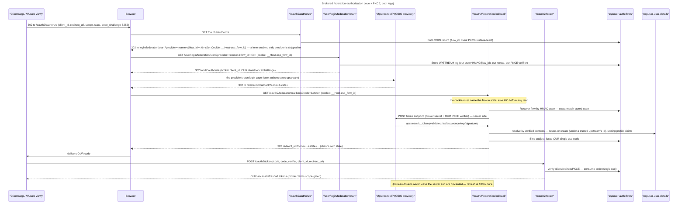

# Brokered Federation

> The federation callback is also where a single-sign-on session is established — see
> [sso-sessions.md](sso-sessions.md).

> Implements the brokered-federation design (the Dex "normalize and reissue"
> broker) for every upstream OIDC provider registered as a provider row
> ([external-provider.md](external-provider.md)).

## What it is

ESP User is its own OIDC issuer. An *upstream identity provider* (for example a
Cognito user pool's hosted UI, or a social provider) authenticates the human, but the downstream client
**never** sees the upstream's tokens. ESP User brokers the upstream login, reads
the verified identity, resolves it to our `user_id`, and mints **our** access /
id / refresh tokens. To the client, ESP User is the only issuer, and refresh is
100% ours — the upstream is never contacted again after the callback.

This is the **user path only.** Admins authenticate against Cognito directly as a
separate issuer with no brokering — users carry the ESP User issuer, admins carry
Cognito's native issuer, and clients serving both validate both ("two issuers").

## Why brokered, not pass-through (security)

The client's downstream leg is unchanged: our `/oauth2/authorize` validates our
client, `redirect_uri`, PKCE and `state`, and issues **our** code bound to **our**
flow record. Federation adds a *second, independent* OAuth leg where ESP User is a
confidential client of the upstream. The two legs never share PKCE/state.

We deliberately do **not** replay the client's own PKCE/state against the upstream
(the way the MCP OAuth proxy does). That pass-through is safe only because the MCP
proxy re-exposes the upstream token unchanged — there is one authorization server
and one PKCE binding. Here we **mint our own tokens**, so a replay would:

- verify PKCE at the *upstream*, not at the token-minting server — our
  `/oauth2/token` would bind the code to nothing it proved possession of;
- collapse every downstream client into one upstream client, destroying the
  client↔code binding and enabling cross-client code injection (RFC 6749 §4.1.3,
  RFC 9700 §4.5);
- leak the client's `state` to a third party and couple our protocol surface to
  the upstream's PKCE/state quirks, breaking the multi-provider goal.

RFC 8693 token-exchange (client integrates the upstream itself, then swaps the
upstream token at our `/oauth2/token`) is **not** the base flow — it exposes
upstream tokens to clients and voice assistants cannot use it. It is reserved as
a future additive grant for native apps (RFC 8693 token exchange: the app presents
an upstream token at our token endpoint and receives OUR tokens).

## The flow, end to end

The two legs never mix: the client's `state`/PKCE ride only the downstream leg;
the broker mints its own `state` (HMAC over the flow id), `nonce`, and PKCE
verifier for the upstream leg.

## Endpoints

Both live on the authorize lambda (same `EspUserApi`), auth type `NONE`.

### `GET /user/login/federation/start`

Begins the upstream leg for an in-flight authorization flow.

- **Input:** `provider` and `flow_id` (query) + the `__Host-esp_flow_id` HttpOnly cookie set by
  `/oauth2/authorize`. `flow_id` names the sign-in the page's link was drawn for and must equal the cookie, else
  `400 flow_replaced` and nothing is sent upstream: a newer sign-in in another tab took the cookie, and following it
  would finish that tab's app.
- **Process:** resolve a live `LOGIN` flow by the cookie; load the provider from
  [`espuser-identity-providers`](#provider-registry) (must be `enabled`, and the client must allow it in `allowed_providers`);
  generate a fresh upstream `state`, `nonce`, and PKCE `code_verifier`/S256
  `code_challenge`; persist them on the flow record; build the upstream authorize
  URL (our broker `client_id`, provider scopes, our callback `redirect_uri`,
  `state`, `nonce`, `code_challenge`).
- **Output:** `302` to the provider `authorization_endpoint`.

State is `flow_id` + an HMAC tag (keyed by a domain-separated derivation of the refresh-token secret) so the callback can trust it without a new GSI, and it is *also* compared to the value stored on the flow. That proves we issued it and nobody altered it. Issuer mix-up is defended by the flow's stored `provider` and the ID token's `iss` check, not by the state. The state does not say which browser is returning: the `__Host-esp_flow_id` cookie set at `/oauth2/authorize` does, so a callback URL copied from someone else's sign-in fails in every browser but the one that started the flow (RFC 6749 §10.12).

### `GET /oauth2/federation/callback`

Completes the upstream leg and issues **our** code.

- **Input:** `code`, `state`, and the `__Host-esp_flow_id` cookie. An RFC 9207 `iss` parameter is not read.
- **Process:**
  1. Verify the `state` HMAC. The `__Host-esp_flow_id` cookie must name the same flow, else `400` with no cookie set and no flow read, so an attacker's own sign-in cannot be finished in a victim's browser (RFC 6749 §10.12). Load the flow; confirm it matches the flow's stored
     upstream `state`. Reject on any mismatch (CSRF/replay).
  2. Exchange `code` at the provider `token_endpoint` server-side, authenticating
     as our confidential broker client (secret) and sending the stored
     `code_verifier` (PKCE).
  3. Verify the upstream `id_token`: RS256 signature against the provider JWKS,
     `iss` == provider issuer, `aud` == our broker `client_id`, `nonce` == the
     flow's stored nonce, and `exp`.
  4. Normalize claims to an `Identity`. A contact the upstream did not mark verified
     (`true`, or the string `"true"`) is dropped, and an identity with nothing verified does
     **not** resolve to an account (rendered as a non-enumerating error). `auth_time` falls
     back to the ID token's `iat` when absent.
  5. Identity resolution against every verified contact, described below. The upstream
     refresh token is discarded — never persisted.
  6. Bind the resolved subject onto the flow (conditional on `subject` empty), then issue our authorization code, or, when the flow's `skip_consent` is not set, hold the sign-in and send the browser to `/user/login/consent` ([authorize-code-flow.md](authorize-code-flow.md#consent--clients-we-do-not-ship)).
- **A provider `error` instead of `code`** (the person cancelled, or the provider failed): the same step-1 checks run first, so only an error tied to this browser's own sign-in leads anywhere. A cancel (`access_denied`, or Apple's `user_cancelled_authorize`) goes back to `/user/login` on the same sign-in when the page offers the client another way in (a row whose password our page takes or an `otp` row it allows, or a second allowed provider); otherwise the sign-in ends and the browser returns to the client's `redirect_uri` with `error=access_denied` and `state`, because `/oauth2/authorize` would send it straight back to the same provider. Any other error is a `400` page offering to start again. An error tied to no sign-in of this browser's is a `400` page with no way on.
- **Output:** `302` to the client `redirect_uri?code=…&state=…`. The client then
  redeems the code at `/oauth2/token` for **our** tokens, exactly as any login.

## Identity resolution

A login can vouch for an email, a phone, or both. **Either contact finds the account**, and a contact
the account did not yet have is recorded on it. So one person stays one user however they sign in
next, and verifying a second contact upstream later does not strand them in a fresh empty account.

| Situation | Outcome |
| --- | --- |
| Neither contact known | New account: under the claim the provider row maps to `sub` ([Attribute mapping](#attribute-mapping)), otherwise under a freshly minted id |
| Neither contact known, and the mapped `sub` is already a taken `user_id` or not a valid OIDC `sub` | Refused with `access_denied`, the same page for every reason so the claim cannot be used to learn which ids exist |
| One contact known | That account is reused; the other contact is recorded on it when the account has none of that kind |
| Both contacts known, same account | That account is reused |
| Both contacts known, **different** accounts | Refused. Choosing one would either strand the other's data or attach this login to the wrong account, so the login fails and an operator decides |
| Nothing verified | Refused |
| The contact lookup itself fails | Treated as neither contact known: a new account is created |

Recording a contact is conditional on the account not already holding one, so a login can never
overwrite another user's email or phone.

## Attribute mapping

A provider row's `attribute_mapping` names, for each of OUR keys, the upstream claim to read; a key it
leaves out reads the default claim. Only these keys are ever read, so a mapping can redirect a claim but
cannot widen what we ingest. Federation and the [password proxy](legacy-user-auth.md) read claims the
same way.

| Our key | Default claim | Used for |
| --- | --- | --- |
| `email`, `email_verified` | same | Identity resolution, by verified contact |
| `phone_number`, `phone_verified` | `phone_number`, `phone_number_verified` | Identity resolution, by verified contact |
| `external_sub` | `sub` | Stored on the account as `external_sub` when the account is created |
| `name`, `locale`, `picture` | same | Stored on the account when it is created; later logins do not update them |
| `given_name`, `family_name` | same | Read, not stored |
| `auth_time`, `acr` | same | Session metadata; an upstream `amr` is not read, since ESP User verified the upstream's token, not its method |
| `sub` | none | When a row maps it (e.g. `custom:user_id`), a new account opens under that claim's value instead of a minted id, so a pool that predates ESP User keeps its own ids |

**What trust rests on.** Mapping `sub` trusts the claim: ESP User cannot tell a real id from one a user
wrote into their own upstream record, so a pool user who can write the mapped claim can open an
account under the id of anyone who has not yet signed in. Before mapping `sub`, every app client on
that pool must set `WriteAttributes` without the mapped claim (an unset list makes every attribute
writable), and our broker client must have it in `ReadAttributes`, or every login mints.
`test/itest/test_tenant_identity_security.py` checks the first on every pool a row maps `sub` for. The
seeded `cognito` row maps no `sub`, and every deploy rewrites that row, keeping only its `enabled`
value, so a `sub` mapping an operator adds to it is replaced on the next deploy.

## Provider selection at `/oauth2/authorize`

After a valid `/oauth2/authorize`, the login surface is chosen by the enabled
provider set:

- **1 enabled provider, an `oidc` row naming no `password_verifier`** → `302` straight to
  `/user/login/federation/start` for it (the app never renders). The count is over every enabled
  row, not the client's `allowed_providers`, so a client that does not allow that provider is
  refused at the start endpoint. Voice-assistant
  account-linking (Alexa/GVA) follows the extra hop transparently — nothing changes in
  their config, which already points at our `/oauth2/authorize` + `/oauth2/token`.
- **Anything else** → `302` to `/user/login`, which carries only `login_hint` and `idp`.
  A lone row whose password our page takes, or a lone `otp` row, is answered there, on our page, so it is never skipped:
  the page collects the password, or the one-time code, itself.

The provider's `type` and `password_verifier` say how it signs in; see [external-provider.md](external-provider.md#the-provider-row).

## Provider registry

DynamoDB table **`espuser-identity-providers`**, PK `provider_name`. Each row is
**self-describing**: everything the broker needs lives on the row, with anything
omitted resolved from the issuer's OIDC discovery document
(`{issuer}/.well-known/openid-configuration`, OpenID Connect Discovery 1.0, cached per container).
Seeded at deploy with the built-in `cognito` row; every deploy rewrites that row, keeping only its
`enabled` value, because the pool's client can change when the pool is replaced. The same fields
are listed in [external-provider.md](external-provider.md#the-provider-row):

| Field | Meaning |
| --- | --- |
| `provider_name` | Key; the value `/user/login/federation/start?provider=` takes. Providers are listed, and a default among them is picked, in `provider_name` order |
| `type` | `oidc` or `otp`. An `otp` row is a one-time code on our page; an `oidc` row signs in as its `password_verifier` says |
| `password_verifier` | On an `oidc` row, who checks a password typed on our page: `cognito` (Cognito `InitiateAuth` against the row's pool; needs a `client_id`). Unset, the row is a button to the provider's own page. Any other value, or the field on an `otp` row, offers neither |
| `enabled` | Whether `/oauth2/authorize` offers it. Unset counts as disabled |
| `display_name` | The label of this provider's "Continue with" button or password form. Names the credential or the brand, never the vendor |
| `logo` | The image on this provider's button: a `data:image/png`, `jpeg` or `webp` base64 URI of at most 4 KiB, the same rule as a client's `logo_uri`, drawn as ``. A row named `google`, `apple` or `github` gets that brand's own "Sign in with" button instead and ignores it; any other value is ignored and the button shows a plain shield |
| `issuer` | The provider's OIDC issuer: the discovery base and the ID token `iss` check |
| `authorize_url` | Where a login begins on an `oidc` row naming no `password_verifier`; absent, it comes from discovery. A row naming one, and an `otp` row, do not read it |
| `client_id` | The one app client we hold for this provider |
| `client_secret` | That client's secret |
| `scopes` | Space-separated, requested on the upstream authorize (default `openid email phone`) |
| `token_endpoint_auth` | How the client authenticates at the token endpoint: `client_secret_basic` (default) or `client_secret_post` |
| `attribute_mapping` | Our claim name → the provider's claim name; see [Attribute mapping](#attribute-mapping) |
| `session_max_ttl_seconds` | Optional cap on our session's retention for federated logins this provider authenticated: retention becomes `min(now + session.SessionTTLSeconds, auth_time + this)` |
| `end_session_url` | The provider's sign-out endpoint. Unset ⇒ the upstream hop is skipped and only our session ends ([external-provider.md](external-provider.md#sign-out--two-fields-here-one-url-there)) |
| `end_session_redirect_param` | The query parameter that provider uses for "come back here afterwards". Defaults to `post_logout_redirect_uri`; Cognito names it `logout_uri` |
| `token_url`, `jwks_url` | Optional pins; absent, they come from discovery |
| `userinfo_url` | Stored on the row; nothing reads it |

An `otp` row is written when the one-time-code provider is installed, so the core needs no
redeploy to gain it.

## Flow-record additions

`espuser-auth-flows` gains (all `omitempty`): `provider`, `upstream_state`,
`upstream_nonce`, `upstream_pkce_verifier`. Written by `federation/start` only while no subject
is bound to the flow, and read by `federation/callback`; they stay on the record until it expires.
No new GSI — the callback loads by flow id recovered from the HMAC state.

## The bundled Cognito pool (CDK)

- The `ESP-End-Users` Cognito user pool (Lite feature plan, self sign-up enabled) with its
  hosted-UI domain.
- **One** confidential client on it, `espuser-idp-broker` (authorization-code grant; scopes
  `openid email phone profile aws.cognito.signin.user.admin`; callback = our
  `/oauth2/federation/callback`; sign-out URL = our `/oauth2/federation/logout/callback`; generated secret).
  No app or assistant client on the pool — those live in our own client registry.
- The seeded `cognito` row: an `oidc` row with `password_verifier` `cognito`, so its password is
  typed on our page; `display_name` `Email / password`; the five scopes above; `end_session_url`
  set to the pool's logout endpoint with `logout_uri` as the return parameter.
- The pool's ID-token keys are fetched at runtime from its discovery document's `jwks_uri` and
  cached per container.

MCP is unaffected: the proxy still fronts our issuer and validates our tokens.

## The sign-in app

`/user/login` and the other pages under `/user/` are specified in [hosted-ui.md](hosted-ui.md).
The login page reads the flow from its cookie and then the flow's client, and draws only the
providers that client allows.

## Sending someone straight to a social provider

A pool that fronts Google, GitHub or Apple can be reached without its hosted UI rendering at all:
the provider row pins an `authorize_url` that already carries `identity_provider=<Name>`, and
Cognito answers that by redirecting straight upstream. This needs **no code** — `AppendQuery` preserves a pinned query string, so it is a registry row and nothing else.
