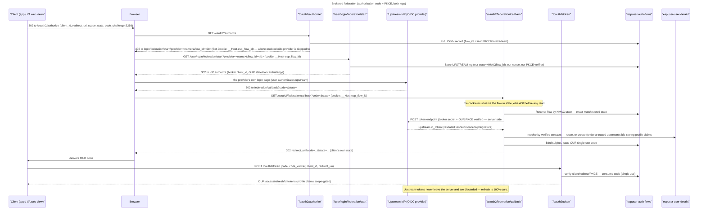

# Brokered Federation

> The federation callback is also where a single-sign-on session is established — see
> [sso-sessions.md](sso-sessions.md).

> Implements the brokered-federation design (the
> Dex "normalize and reissue" broker) for the first concrete upstream provider,
> **AWS Cognito**. This spec is the authoritative description of what is built;

## What it is

ESP User is its own OIDC issuer. An *upstream identity provider* (here, a Cognito
user pool with its hosted UI) authenticates the human, but the downstream client
**never** sees the upstream's tokens. ESP User brokers the upstream login, reads
the verified identity, resolves it to our `user_id`, and mints **our** access /
id / refresh tokens. To the client, ESP User is the only issuer, and refresh is
100% ours — the upstream is never contacted again after the callback.

This is the **user path only.** Admins authenticate against Cognito directly as a
separate issuer with no brokering — users carry the ESP User issuer, admins carry
Cognito's native issuer, and clients serving both validate both ("two issuers").


## Why brokered, not pass-through (security)

The client's downstream leg is unchanged: our `/oauth2/authorize` validates our
client, `redirect_uri`, PKCE and `state`, and issues **our** code bound to **our**
flow record. Federation adds a *second, independent* OAuth leg where ESP User is a
confidential client of the upstream. The two legs never share PKCE/state.

We deliberately do **not** replay the client's own PKCE/state against the upstream
(the way the MCP OAuth proxy does). That pass-through is safe only because the MCP
proxy re-exposes the upstream token unchanged — there is one authorization server
and one PKCE binding. Here we **mint our own tokens**, so a replay would:

- verify PKCE at the *upstream*, not at the token-minting server — our
  `/oauth2/token` would bind the code to nothing it proved possession of;
- collapse every downstream client into one upstream client, destroying the
  client↔code binding and enabling cross-client code injection (RFC 6749 §4.1.3,
  RFC 9700 §4.5);
- leak the client's `state` to a third party and couple our protocol surface to
  the upstream's PKCE/state quirks, breaking the multi-provider goal.

RFC 8693 token-exchange (client integrates the upstream itself, then swaps the
upstream token at our `/oauth2/token`) is **not** the base flow — it exposes
upstream tokens to clients and voice assistants cannot use it. It is reserved as
a future additive grant for native apps (RFC 8693 token exchange: the app presents
an upstream token at our token endpoint and receives OUR tokens).

## The flow, end to end



The two legs never mix: the client's `state`/PKCE ride only the downstream leg;
the broker mints its own `state` (HMAC over the flow id), `nonce`, and PKCE
verifier for the upstream leg.

## Endpoints

Both live on the authorize lambda (same `EspUserApi`), auth type `NONE`.

### `GET /user/login/federation/start`

Begins the upstream leg for an in-flight authorization flow.

- **Input:** `provider` and `flow_id` (query) + the `__Host-esp_flow_id` HttpOnly cookie set by
  `/oauth2/authorize`. `flow_id` names the sign-in the page's link was drawn for and must equal the cookie, else
  `400 flow_replaced` and nothing is sent upstream: a newer sign-in in another tab took the cookie, and following it
  would finish that tab's app.
- **Process:** resolve a live `LOGIN` flow by the cookie; load the provider from
  [`espuser-identity-providers`](#provider-registry) (must be `enabled`, and the client must allow it in `allowed_providers`);
  generate a fresh upstream `state`, `nonce`, and PKCE `code_verifier`/S256
  `code_challenge`; persist them on the flow record; build the upstream authorize
  URL (our broker `client_id`, provider scopes, our callback `redirect_uri`,
  `state`, `nonce`, `code_challenge`).
- **Output:** `302` to the provider `authorization_endpoint`.

State is `flow_id` + an HMAC tag (keyed by a domain-separated derivation of the refresh-token secret) so the callback can trust it without a new GSI, and it is *also* compared to the value stored on the flow. That proves we issued it and nobody altered it, and defends against issuer mix-up (RFC 9207). It does not say which browser is returning: the `__Host-esp_flow_id` cookie set at `/oauth2/authorize` does, so a callback URL copied from someone else's sign-in fails in every browser but the one that started the flow (RFC 6749 §10.12).

### `GET /oauth2/federation/callback`

Completes the upstream leg and issues **our** code.

- **Input:** `code`, `state` (+ optional `iss`), and the `__Host-esp_flow_id` cookie.
- **Process:**
  1. Verify the `state` HMAC. The `__Host-esp_flow_id` cookie must name the same flow, else `400` with no cookie set and no flow read, so an attacker's own sign-in cannot be finished in a victim's browser (RFC 6749 §10.12). Load the flow; confirm it matches the flow's stored
     upstream `state`. Reject on any mismatch (CSRF/replay). If `iss` is present,
     assert it equals the provider's issuer (RFC 9207).
  2. Exchange `code` at the provider `token_endpoint` server-side, authenticating
     as our confidential broker client (secret) and sending the stored
     `code_verifier` (PKCE).
  3. Verify the upstream `id_token`: RS256 signature against the provider JWKS,
     `iss` == provider issuer, `aud` == our broker `client_id`, `nonce` == the
     flow's stored nonce, and `exp`.
  4. Normalize claims to an `Identity`. A contact the upstream did not mark verified is
     dropped, and an identity with nothing verified does **not** resolve to an account
     (rendered as a non-enumerating error).
  5. Identity resolution against every verified contact, described below. The upstream
     refresh token is discarded — never persisted.
  6. Bind the resolved subject onto the flow (conditional on `subject` empty), then issue our authorization code, or, when the flow's `skip_consent` is not set, hold the sign-in and send the browser to `/user/login/consent` ([authorize-code-flow.md](authorize-code-flow.md#consent--clients-we-do-not-ship)).
- **A provider `error` instead of `code`** (the person cancelled, or the provider failed): the same step-1 checks run first, so only an error tied to this browser's own sign-in leads anywhere. A cancel (`access_denied`, or Apple's `user_cancelled_authorize`) goes back to `/user/login` on the same sign-in when the page offers the client another way in (a row whose password our page takes or an `otp` row it allows, or a second allowed provider); otherwise the sign-in ends and the browser returns to the client's `redirect_uri` with `error=access_denied` and `state`, because `/oauth2/authorize` would send it straight back to the same provider. Any other error is a `400` page offering to start again. An error tied to no sign-in of this browser's is a `400` page with no way on.
- **Output:** `302` to the client `redirect_uri?code=…&state=…`. The client then
  redeems the code at `/oauth2/token` for **our** tokens, exactly as any login.

## Identity resolution

A login can vouch for an email, a phone, or both. **Either contact finds the account**, and a contact
the account did not yet have is recorded on it. So one person stays one user however they sign in
next, and verifying a second contact upstream later does not strand them in a fresh empty account.

| Situation | Outcome |
| --- | --- |
| Neither contact known | New account: under the claim the provider row maps to `sub` ([Attribute mapping](#attribute-mapping)), otherwise under a freshly minted id |
| Neither contact known, and the mapped `sub` is already a taken `user_id` or not a valid OIDC `sub` | Refused with `access_denied`, the same page for every reason so the claim cannot be used to learn which ids exist |
| One contact known | That account is reused; the other contact is recorded on it |
| Both contacts known, same account | That account is reused |
| Both contacts known, **different** accounts | Refused. Choosing one would either strand the other's data or attach this login to the wrong account, so the login fails and an operator decides |
| Nothing verified | Refused |

Recording a contact is conditional on the account not already holding one, so a login can never
overwrite another user's email or phone.

## Attribute mapping

A provider row's `attribute_mapping` names, for each of OUR keys, the upstream claim to read; a key it
leaves out reads the default claim. Only these keys are ever read, so a mapping can redirect a claim but
cannot widen what we ingest. Federation and the [password proxy](legacy-user-auth.md) read claims the
same way.

| Our key | Default claim | Used for |
| --- | --- | --- |
| `email`, `email_verified` | same | Identity resolution, by verified contact |
| `phone_number`, `phone_verified` | `phone_number`, `phone_number_verified` | Identity resolution, by verified contact |
| `external_sub` | `sub` | Stored on the account as `external_sub` |
| `name`, `locale`, `picture` | same | Stored on the account |
| `given_name`, `family_name` | same | Read, not stored |
| `auth_time`, `amr`, `acr` | same | Session metadata |
| `sub` | none | When a row maps it (e.g. `custom:user_id`), a new account opens under that claim's value instead of a minted id, so a pool that predates ESP User keeps its own ids |

**What trust rests on.** Mapping `sub` trusts the claim: ESP User cannot tell a real id from one a user
wrote into their own upstream record, so a pool user who can write the mapped claim can open an
account under the id of anyone who has not yet signed in. Before mapping `sub`, every app client on
that pool must set `WriteAttributes` without the mapped claim (an unset list makes every attribute
writable), and our broker client must have it in `ReadAttributes`, or every login mints.
`test/itest/test_tenant_identity_security.py` checks the first on every pool a row maps `sub` for. The
seeded `cognito` row maps no `sub`, and keeps one an operator adds across redeploys.

## Provider selection at `/oauth2/authorize`

After a valid `/oauth2/authorize`, the login surface is chosen by the enabled
provider set:

- **1 enabled provider, an `oidc` row** → `302` straight to
  `/user/login/federation/start` for it (the app never renders). Voice-assistant
  account-linking (Alexa/GVA) follows the extra hop transparently — nothing changes in
  their config, which already points at our `/oauth2/authorize` + `/oauth2/token`.
- **Anything else** → `302` to `/user/login`, which carries only `login_hint` and `idp`.
  A lone row whose password our page takes, or a lone `otp` row, is answered there, on our page, so it is never skipped:
  the page collects the password, or the one-time code, itself.

The provider's `type` and `password_verifier` say how it signs in; see [external-provider.md](external-provider.md#the-provider-row).

## Provider registry

<a id="provider-registry"></a>

DynamoDB table **`espuser-identity-providers`**, PK `provider_name`. Each row is
**self-describing**: everything the broker needs lives on the row, with anything
omitted resolved from the issuer's OIDC discovery document
(`{issuer}/.well-known/openid-configuration`, RFC 8414, cached per container).
Seeded at deploy with the built-in `cognito` row (refreshing put — the pool id/client
can change on pool replacement). Fields:

| field | meaning |
| --- | --- |
| `provider_name` | stable id, e.g. `cognito` |
| `type` | `oidc` (a redirect to the provider's own page, or a password on our page when `password_verifier` is set) / `otp` (one-time code on our page, enterprise addon) |
| `password_verifier` | on an `oidc` row, who checks a password typed on our page: `cognito` (the row's pool, via `InitiateAuth`; needs a `client_id`). Unset means a redirect; an unknown value offers nothing |
| `enabled` | drives selection above |
| `display_name` | the label on this provider's button |
| `issuer` | upstream OIDC issuer (discovery base + id_token `iss` check) |
| `client_id` | our broker client id at the upstream |
| `client_secret` | the app client secret |
| `scopes` | space-separated upstream scopes (default `openid email phone`) |
| `token_endpoint_auth` | `client_secret_basic` (default) or `client_secret_post` |
| `attribute_mapping` | OUR claim name → upstream claim name; see [Attribute mapping](#attribute-mapping) |
| `authorize_url` | where a login begins: the upstream authorize endpoint of an `oidc` row; rows with a `password_verifier`, and `otp` rows, do not read it |
| `token_url` / `userinfo_url` | optional pins; absent → OIDC discovery |
| `jwks_url` | optional URL pin for the upstream JWKS; absent → fetched from discovery `jwks_uri` |

The enterprise OTP addon writes its own `otp` row at install, so the core needs no
redeploy to gain a provider. Future admin CRUD for providers lands on this table.

## Flow-record additions

`espuser-auth-flows` gains (all `omitempty`): `provider`, `upstream_state`,
`upstream_nonce`, `upstream_pkce_verifier`. Written by `federation/start`, read +
cleared by `federation/callback`. No new GSI — the callback loads by flow id
recovered from the HMAC state.

## Cognito as the first provider (CDK)

- Re-add the `ESP-Users` Cognito user pool + hosted-UI domain (settings copied
  from the pre-OIDC `main`; helpers in `app_common.py`).
- **One** confidential broker client `espuser-idp-broker` (auth-code grant,
  scopes `openid email phone`, callback = our `/oauth2/federation/callback`,
  `generate_secret`). No app or assistant client on the pool — those
  live in our own client registry.
- Fetch the pool JWKS into SSM (reuse the admin-pool `jwks_fetcher_lambda`
  pattern) for the `id_token` signature check.
- Seed the `cognito` provider row.

MCP is unaffected: the proxy still fronts our issuer and validates our tokens.

## The sign-in app

`/user/login` serves a small Preact application, built by Vite and compiled into the authorize
Lambda with `go:embed`. It lives in `src/espuser/hosted-ui/`.

**Embedded, not uploaded.** The UI and the backend that serves it are one artifact: they cannot
deploy out of step, a rollback of one is a rollback of both, and there is no bucket or distribution
to invalidate.

**Same origin, so the policy can be absolute.** Every asset comes from this issuer, which is what
lets the page send:

```
default-src 'none'; script-src 'sha256-<script>'; style-src 'sha256-<stylesheet>'; img-src 'self' data:;
connect-src 'self'; form-action 'self'; frame-ancestors 'none'; base-uri 'none'
```

The Lambda inlines the built script and stylesheet into every page at start-up and admits exactly those bytes by their SHA-256 hashes, so a page is one response with nothing else to fetch, and no other script can run. No CDN, no analytics, no remote fonts. Its routes (`/user/login/password`, `/user/login/restart`, `/user/login/consent`, `/user/logout`) all sit under `/user/`, because the page's references are relative and resolve against it, which keeps whatever stage or base path the browser arrived on.

**What it decides.** An `oidc` row whose `password_verifier` is `cognito`, with a `client_id`, is answered on our own form; an `oidc` row naming no `password_verifier` is a redirect; any other row is left out. With one such pool the form asks for an email and password and names no pool; with several, each is a button beside the redirects, and the pressed one is sent as the `provider` of `POST /user/login/password`. Brand marks ship inside the app, never from the registry, because markup from an operator-written row on a sign-in page is markup somebody else controls. A row named `google`, `apple` or `github` gets that brand's own button; any other draws a plain "Continue with" row, showing the row's `logo` when it is a valid inline image (drawn as ``, which runs no script) and a shield otherwise.

**The terminal error page is the same app**, told it cannot proceed.

## What the sign-in page is told

The page is described in one block delivered with the HTML, `<script type="application/json" id="esp-page-data">`, so the form is on screen at first paint and there is no second endpoint to authorize. The browser never executes `application/json`, so the block needs no CSP nonce.

| Field | What the page does with it |
| --- | --- |
| `client.name`, `client.logo_uri` | Name the relying party, and on the consent screen show its logo |
| `providers[]` | One entry per provider this client may use, in `provider_name` order, each carrying its `method` (`password` for our form, `redirect` for the provider's own page, never the row's `type`) and, for a brand's own button (a row named `google`, `apple` or `github`), `brand`, else a checked `logo` |
| `otp_enabled` | Whether to offer code sign-in at all |
| `flow_id` | The sign-in the page was drawn for, sent back with every answer so one a newer sign-in replaced is refused (`flow_replaced`) |
| `login_hint`, `idp` | Prefill the username, preselect a provider. Suggestions from the relying party, never decisions — nothing is authorized on them |
| `restart_url` | Where "start again" points |
| `consent`, `logout`, `signed_out`, `error` | Draw the consent screen, the sign-out question, the signed-out page or the terminal error instead of the form |
| `links` | The operator's Support, Privacy and Terms pages for the footer, from `support_url`, `privacy_url` and `terms_url` under `espuser-core` in `rmng-inputs.json`; only absolute `https` URLs are passed, and an unset one is not drawn |

The login page reads the flow from its cookie and then the flow's client, and draws only the providers that client allows, under the client's registered name; one registry scan feeds the provider list. A flow that expired draws the "Start again" error screen and no form; a flow whose row is gone, or no cookie at all, leaves nothing to restart, so its error screen has no "Start again".

## Sending someone straight to a social provider

A pool that fronts Google, GitHub or Apple can be reached without its hosted UI rendering at all:
the provider row pins an `authorize_url` that already carries `identity_provider=<Name>`, and
Cognito answers that by redirecting straight upstream. This needs **no code** — `AppendQuery` preserves a pinned query string, so it is a registry row and nothing else.

## Deferred (tracked)

- Native RFC 8693 token-exchange grant; profile re-sync `sync_mode`.
- Linking an existing account to an upstream identity, which also restores access after an
  upstream email change (today the taken `user_id` refuses its owner). -- We won't do this as fo rNeo email/phone is the primary identity.
