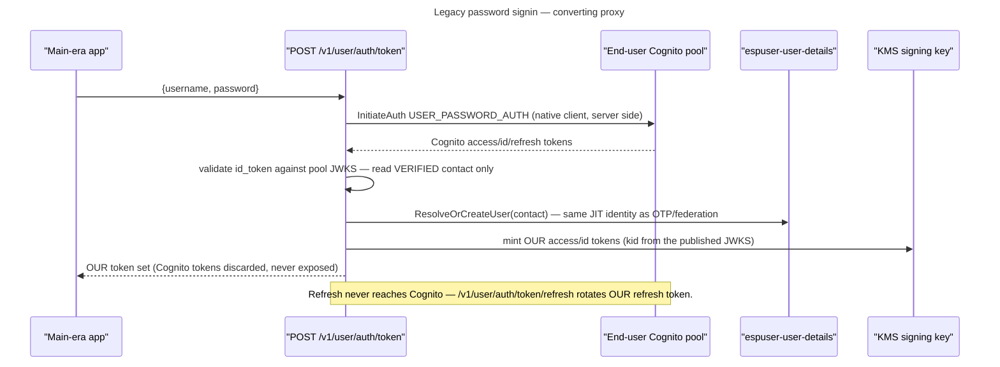
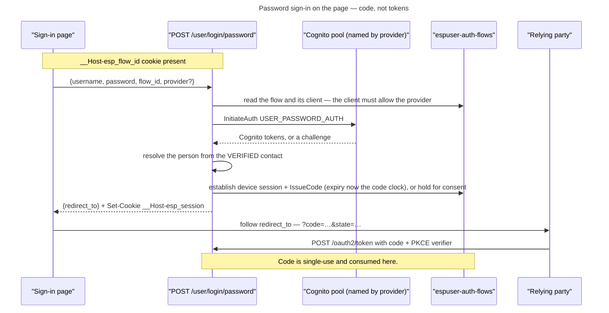

# Native Auth

> **Compatibility exception to the "users are passwordless" decision.**
> Apps built against `main` call the native `/v1/user/auth/*` endpoints
> (username+password login, signup, verify, password recovery/change). Those
> endpoints are restored here **byte-compatibly** so existing apps keep working,
> but they are converting proxies: authentication happens against the Cognito
> end-user pool (the same pool the [federation broker](federation.md) uses), and
> the tokens returned are **ESP User's own** — never Cognito's.
>
> New clients should use the OIDC browser flow (`/oauth2/authorize`) or OTP; this
> surface is legacy-only and slated for removal once main-era apps migrate.

## Contract (unchanged from `main`)

Same paths, request bodies, and response shapes as `main`, so a main-era client
needs no change:

| Route | Body | Returns |
|---|---|---|
| `POST /v1/user/auth/token` | `{username, password, provider?}` | token set |
| `POST /v1/user/auth/token/refresh` | `{refresh_token, resource?}` | token set |
| `POST /v1/user/auth/signup` | `{email?\|phone_number?, password, provider?}` | `{user_id, requires_verification, message}` |
| `POST /v1/user/auth/signup/verify` | `{email?\|phone_number?, code, provider?}` | `{message}` |
| `POST /v1/user/auth/password-recovery` | `{username, provider?}` | `{message}` |
| `POST /v1/user/auth/password-recovery/confirmation` | `{username, code, new_password, provider?}` | `{message}` |
| `POST /v1/user/auth/password` | `{old_password, new_password}`, our access token as `Authorization: Bearer` | `{message}` |
| `POST /v1/user/auth/signout` | `{access_token?, refresh_token?, global?}` | `{message}` |

Every route that reaches a Cognito pool by name (sign-in, signup, signup verify, password recovery and its confirmation) takes an optional `provider` naming the pool, so an account in any password pool can be created, signed in and recovered; the sign-in page sends it, and a main-era client omits it. A password change takes its pool from the caller's token instead, and refresh and signout touch only our own tokens; none of them takes `provider`.

A password change verifies the access token first and lets its `idp` claim pick the pool: a token whose `amr` contains `pwd` changes the password of the provider its `idp` names, and a token from any other sign-in (federated, one-time code, or a provider without a password ESP User checks) is refused before any pool is called with `403 You signed in through <provider>. This doesn't support password change.`, where `<provider>` is the provider row's display name, else its name, else the token's `idp` when no enabled row holds it. A token without `idp` (issued before tokens carried it) uses the default password provider, the first by name. A `provider` an older client still sends in the body is ignored.

Token response fields (RFC 6749 §5.1 names): `access_token`, `refresh_token`,
`id_token`, `token_type` (`Bearer`), `expires_in`, `scope` (the granted scope, never `offline_access`), `must_change_password`.

## The flow, end to end

## The same credentials, on the sign-in page

A browser on the sign-in page is one leg of somebody else's authorization flow. It gets an
authorization code and a session, never a token set: tokens in the page would step over the
client's PKCE binding, and the login would leave no device row for the session list or sign-out to
reach. So the page's password form does not call `/v1/user/auth/token`; it posts to
`POST /user/login/password`, which verifies the password against the same Cognito pool and finishes the browser's flow.

The `__Host-esp_flow_id` cookie names the flow, and the body's `flow_id` must name the same one, so a tab drawn for an older sign-in cannot finish a newer one.

## How long a sign-in has

A sign-in must reach a code within **15 minutes** of `/oauth2/authorize`; the flow holds the
client's request, never a credential. Once a code is issued it has its own **10 minutes**, single-use
(RFC 6749 §4.1.2). An expired sign-in offers "start again": `GET /user/login/restart` re-runs the
original `/oauth2/authorize` request, so the relying party never notices.

## Choosing a provider

`provider` names the registry row to authenticate against, and it must be an enabled `oidc` row whose
`password_verifier` is `cognito` and that carries a `client_id`. Omitted, the first such row by `provider_name` answers — never the order
DynamoDB happened to return, so two equally-valid pools cannot resolve differently between one request
and the next.

A named provider that is not such a row is **refused** (`400`, `Unknown provider.`: `invalid_request` on the password form, `{"message"}` on the native routes). It
does not fall back: the caller asked for a specific pool, and quietly using another would resolve
the person to a different account.

On the password form the client's own `allowed_providers` is checked as well, before the password
reaches the pool, and a client that cannot be read refuses. `/v1/user/auth/token` checks the Home app
client's the same way (`403`), since it mints that client's tokens; the account routes do not, because
the sign-in page also uses them for other clients' sign-ins.

## How a sign-in on the page fails

Cognito answers some correct passwords with a challenge rather than tokens; those are their own outcome, because "authentication failed" would be both wrong and unactionable. Our page answers no challenge, so a pool that requires MFA or another Cognito challenge must be registered as an `oidc` row, whose own hosted UI runs it. Every failure is an OAuth error code the page acts on:

| Condition | Error | Status |
| --- | --- | --- |
| Wrong password **or** no such account, one answer for both so the form is no account-existence oracle | `invalid_credentials` | 401 |
| Account never verified | `unconfirmed_account` | 403 |
| Created by an administrator, has never chosen a password; forgot password cannot clear this | `new_password_required` | 403 |
| Reset by an administrator; forgot password sets the new one | `password_reset_required` | 403 |
| The client does not allow the provider | `provider_not_allowed` | 403 |
| A login no account of ours can take (no verified contact, contacts held by two accounts, an upstream id another account holds) | `access_denied` | 403 |
| The sign-in expired or no longer exists, or there is no flow cookie | `expired_flow` | 400 |
| `flow_id` is not the flow cookie's | `flow_replaced` | 400 |
| A `provider` that is not an enabled row whose `password_verifier` is `cognito` and that has a `client_id`, or a body that is not JSON | `invalid_request` | 400 |
| The pool failed rather than refused (throttling, a missing app client, a wrong client secret, a network error), or the password was accepted but a step of ours failed | `server_error` | 500 |

## Token conversion

- **`/token`**: `InitiateAuth USER_PASSWORD_AUTH` against the Cognito end-user
  pool. On success, read the authenticated user's verified email/phone from the
  Cognito id token, run [identity resolution](federation.md#identity-resolution)
  (reading claims through the provider row's [attribute mapping](federation.md#attribute-mapping)), and mint **our** access/id/refresh tokens. The Cognito tokens
  are discarded. So a legacy password login and a federated/OTP login for the same
  verified contact resolve to the same `user_id` and issue the same shape of token.
  The tokens are for the RainMaker Home app's client, `rainmaker-neo-home-app-client` (espuser-base
  `EspUserClientId`), whichever app calls: a refresh token renews only with the client it was issued to,
  so the app's password sign-ins keep renewing once it signs in through the browser with that client.
  Like the client id, the resource is not a parameter here: the sign-in covers every API the password
  client's `allowed_resources` name, and its access token is for the client's `default_resource`
  ([resource-indicators.md](resource-indicators.md)).
- **`/token/refresh`**: rotates **our** refresh token via our refresh service —
  it never calls Cognito. See rotation note below. `resource`, an array of at most one,
  picks which of the sign-in's APIs the renewed access token is for.
- **signup / verify / password-recovery / password**: operate directly on the
  Cognito pool (`SignUp`, `ConfirmSignUp`, `ForgotPassword`, `ConfirmForgotPassword`,
  `ChangePassword`), exactly as `main`. These do not mint tokens.
- **signout**: revokes **our** refresh token / family through our revoke path as the Home app client, so a token issued to another client is refused with `401`. A missing refresh token is
  rejected rather than reported as success, and a global signout request is refused: our sessions are
  refresh families of ours, which a provider-side sign-out does not touch, so a success there would
  mean nothing was ended.
- **password**: the client presents our access token in the `Authorization: Bearer` header (RFC 6750 s2.1) and the old password in the body. The token is verified
  before anything else, because it names whose password is being changed, and it may be addressed
  to any of our APIs ([resource-indicators.md](resource-indicators.md)). The old password is then
  re-presented to the provider to obtain a provider access token, which is what the provider's
  change-password operation requires — the client never holds one.
- **Sessions after a password event**: a new password ends the sessions the old one could have opened. Once the provider accepts a change, every browser and app session of the caller is signed out, the caller's own included, and every refresh family deleted, `offline_access` grants too, so the person signs in again and relinks their connected apps; a change is what someone makes when they think another person knows the old password. Once the provider accepts a recovery confirmation, the service signs in once with the new password and signs out every session of the account the ID token's verified email and phone name, found as sign-in finds it but never created; the typed username picks no account, because the pool may hold it as an unverified alias of someone else's address. Grants made with `offline_access` survive a reset ([sso-sessions.md](sso-sessions.md#offline-grants)), because forgetting a password says nothing about who else holds it. A pool user no account holds yet has nothing to end. A sign-in that answers with a challenge (MFA, a forced new password) confirms no account, so the reset succeeds and ends nothing (logged as a warning); verified contacts held by two accounts end nothing either and answer the 500 below, as sign-in refuses them. If the password changed but the sessions could not be signed out, a change answers `500 Password changed, but sessions could not be signed out` and a reset `500 Password reset, but sessions could not be signed out`, so the person knows the new password works and can sign out everywhere.

## Refresh rotation

`/token/refresh` rotates on every use and revokes the whole family on reuse —
identical to the OIDC `/oauth2/token` grant, with no per-grant exception. Every
response carries the new `refresh_token`, so a client must persist what it is
given and present that on the next refresh.

This is a deliberate divergence from `main`, whose Cognito refresh echoed the same
token back indefinitely: a client that re-sends an already-redeemed token is
treated as token theft and its login is terminated. Rotation is the point of the
refresh service (RFC 9700 §4.14), and exempting this grant would have meant
carrying a permanently weaker path for the one surface most likely to be attacked.

## Enumeration resistance

Every route answers the same whether or not the named account exists, so none of
this surface can be used to probe which contacts are registered:

| Operation | Account exists | Account does not exist |
|---|---|---|
| Sign-in (`/token`), wrong/any password | 401 `Authentication failed` | 401 `Authentication failed` |
| Signup (`/signup`) | 201 `Code sent. Existing RainMaker users must signin or reset password.` — a code is re-sent **only** for an unconfirmed account retrying with its correct password; a confirmed account or a wrong password gets no mail (see below) | 201 same message — account created, code sent |
| Signup verify (`/signup/verify`), wrong/any code | 400 `Invalid code or RainMaker account already exists. Try signin or reset password.` | 400 same message |
| Password recovery (`/password-recovery`) | 200 `If your account exists, you will receive a code` — code sent | 200 same message — nothing sent |
| Recovery confirmation (`/password-recovery/confirmation`) | 400 `Invalid verification code` without the mailed code | 400 `Invalid verification code` |
| Change password (`/password`) | 401 `Password change failed` unless the caller's own access token and old password both check out — no account probe possible without a token | 401 `Password change failed` |
| Signup and recovery confirmation (`/signup`, `/password-recovery/confirmation`), with a password the pool's policy refuses | 400 `Password does not meet the password requirements` | 400 same message for `/password-recovery/confirmation`, whatever order the pool checks the code, the account and the policy in |

### Duplicate signup: how the resend is decided

`SignUp` raises `UsernameExistsException` for confirmed and unconfirmed accounts alike, and
`ConfirmSignUp`/`ResendConfirmationCode` cannot tell them apart either (measured against a real
pool — Cognito validates the code before the account state, and the resend happily mails a
confirmed account). The one call that separates the two with only an app client is
`InitiateAuth` with the password the caller just submitted: `UserNotConfirmedException` is
raised only for an unconfirmed account, and only after the password matched. So the code is
re-sent exclusively on that signal; everything else — confirmed account, wrong password, MFA
challenge — gets the same 201 and no mail.

Sign-in names the account's state only after the **correct** password: an unconfirmed account gets
`Signin failed. Account not verified — reset your password.`, one an administrator reset gets
`Signin failed. Password reset required — reset your password.`, and one an administrator created
gets `Signin failed. This account needs a new password — contact support.` Since Cognito checks the
password first, each is reachable only by someone already holding the credential. The sign-in page's
`POST /user/login/password` sends the same sentences as `error_description` (they live in
`legacyauth`).

`/signup/verify` is fully uniform — every failure, unknown user included, answers the same 400,
and the message itself carries the sign-in/reset hint so a user who signed up twice is not
stranded.

An `AliasAttributes` pool cannot serve this surface at all: Cognito refuses email-format
usernames on that shape, and this surface signs up with the email as the username. Signup fails
with the masked 400 (`Failed to create user account`).

### Provider-specific wording

Two messages name the product, and only when RainMaker's own pool backs the deployment:

| Message | Inbuilt (`provider_name = "cognito"`) | Registered external provider |
|---|---|---|
| signup 201 | `Code sent. Existing RainMaker users must signin or reset password.` | `Code sent. Existing users must signin or reset password.` |
| account exists 409 | `Account already exists. RainMaker users: signin or reset password.` | `Account already exists. Signin or reset password.` |
| verify failure 400 | `Invalid code or RainMaker account already exists. Try signin or reset password.` | `Invalid code or account already exists. Try signin or reset password.` |

## Security notes

- Password auth is ROPC-shaped, which OAuth 2.1 / RFC 9700 §2.4 discourage; it is
  retained **only** for backward compatibility and is not offered to new clients.
- Conversion means Cognito tokens never reach the client, so the client trust
  boundary is unchanged from the all-OIDC design.
- All eight routes are unauthenticated at the gateway; `POST .../password`
  and `.../signout`, which carry the caller's `access_token` in the body (as on
  `main`).
