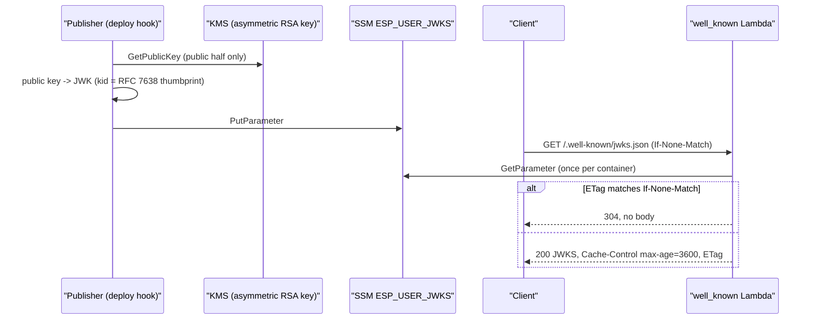

# OIDC Discovery & JWKS

## What this is

The read-only discovery documents an OAuth/OIDC client fetches **before** it ever
calls us — to learn where our endpoints are and how to verify our tokens. Three
static documents:

| Endpoint                                  | Purpose                       | Standard             |
| ----------------------------------------- | ----------------------------- | -------------------- |
| `/.well-known/openid-configuration`       | OIDC provider metadata        | OpenID Discovery 1.0 |
| `/.well-known/oauth-authorization-server` | OAuth 2.0 AS metadata         | RFC 8414             |
| `/.well-known/jwks.json`                  | Public signing keys (JWK Set) | RFC 7517             |

## Why it is needed

A client must discover endpoint URLs, supported grants/scopes, and the keys to
verify issued tokens. OIDC clients read `openid-configuration`; plain OAuth 2.0
clients read `oauth-authorization-server` (same data, RFC 8414 field names). Both
point at `jwks.json` for the public keys.

## Pre-requisites

- One RSA signing key exists as a **KMS asymmetric key** (`RSA_2048`,
  `SIGN_VERIFY`); the private half never leaves KMS. The public half is published
  in JWKS. (A `SecureString` PEM in SSM Parameter Store remains a **local/dev
  fallback**, used only when `ESPUSER_KMS_SIGNING_KEY_ARN` is unset.)
- The deployment `issuer` (public base URL) is known.

## Signing key (KMS)

- **Where it lives.** The signing key is a KMS asymmetric RSA key. The token
  minter signs by sending the token's SHA-256 **digest** to `kms:Sign`
  (`SigningAlgorithm=RSASSA_PKCS1_V1_5_SHA_256`, `MessageType=DIGEST`), which is
  exactly RS256 — so the JWS the minter assembles verifies against a standard
  RSA public key with no KMS on the verify path. The private key material is
  never exported; a lambda holds only `kms:Sign` (mint) or `kms:GetPublicKey`
  (publish), never the key bytes.
- **`kid` = RFC 7638 JWK thumbprint** of the public key. The minter and the JWKS
  publisher both derive it from the same public key, so they agree without
  sharing state, and it changes **iff** the key changes — which is precisely
  when a rotation wants a new `kid`.
- **Rotation.** A new KMS key yields a new thumbprint `kid`; publish an overlap
  JWKS containing both keys for at least `max(access-token TTL, JWKS cache =
  3600s)` before retiring the old key. Verifiers cache the JWKS without
  refetching on an unknown `kid`, so a key **addition** needs a consumer refresh
  (a redeploy does this); a key **removal** is only safe after the overlap.
- **Provider parity.** `jwtutils.Minter` signs through a `crypto.Signer`, so the
  KMS signer (production) and a local `*rsa.PrivateKey` (tests, dev fallback)
  share one code path and produce identical RS256 output.

## Key Rules

- **RS256 only.** Sole signing alg; `alg: none` rejected (RFC 8725).
- **`issuer` = deployment base URL.** Every URL in all three docs is built from
  it; `jwks_uri` = `<issuer>/.well-known/jwks.json`.
- **Public, cacheable, built per request.** No secrets — JWKS publishes only public
  JWKs. The well-known Lambda serves all three from the issuer's host; nothing is stored.
- **Issuer is fixed once chosen.** It is signed into every token, so changing it
  is a migration, not a toggle.
- **Token responses are never cached.** Every response carrying tokens (`/oauth2/token` and the legacy `/v1/user/auth/token` and `/token/refresh`) sends `Cache-Control: no-store` and `Pragma: no-cache` (RFC 6749 §5.1).

## Token usage: id token vs access token

The two issued JWTs serve distinct purposes, per OpenID Connect Core 1.0 token
semantics:

- **The id token identifies the user.** It is the identification artifact,
  consumed at the userinfo endpoint
  ([auth-flows.md](auth-flows.md#userinfo-endpoint-get-oauth2userinfo)); it is
  not an authorization credential for a resource server.
- **The access token authorizes actions.** It is the RFC 6749 / RFC 6750
  bearer credential a relying party presents to act on the user's behalf — for
  example, to obtain short-lived AWS/IoT credentials. Keeping the two separate
  avoids handing the id token to a resource surface it was not issued for.

### How the person signed in: `amr` and `idp`

User ID and access tokens (never `client_credentials` tokens) carry two claims about the sign-in, each left out when unknown:

| Claim | Meaning | Values |
|---|---|---|
| `amr` | Methods ESP User itself verified (OIDC Core 1.0 §2, values from RFC 8176; RFC 9068 §2.2.1 allows it in access tokens) | `["pwd"]` for a password checked by the password API or the sign-in page's password form, `["otp"]` for a one-time code. A federated sign-in (Google, GitHub, a provider's own page, any upstream OIDC) has none: ESP User verified a signed upstream ID token, not a password, and an upstream `amr` is never copied. |
| `idp` | The provider row that authenticated the person, the session row's `provider` | e.g. `rainmaker`, `google`, `github`, `otp`. Not an OIDC-registered claim; Microsoft Entra ID and Okta issue the same name. |

Storage names the provider `provider` everywhere; `idp` is only the claim. The code exchange takes both from the flow record's `provider` and `amr`, which the sign-in (or a silent SSO answer, from the session row) wrote, replacing the provider of a federation leg the person abandoned on the same flow; a refresh takes them from the refresh family's `provider` and `amr`, recorded next to `auth_time` when it is created, so neither path reads the session. A family created before the claims were recorded renews without them. An app shows "Change password" only when the ID token's `amr` contains `pwd`; the password change itself is decided by `idp` (see [legacy-user-auth.md](legacy-user-auth.md)). Discovery lists both in `claims_supported`.

> The access token issued here is what a relying party exchanges for AWS/IoT
> credentials via Cognito identity-pool OIDC federation; that mechanism (the
> identity pool, the device-users role, STS `AssumeRoleWithWebIdentity`) is
> owned by the ESP RainMaker Neo side — see
> [user_auth.md](../user_auth.md).

## Design

The ESP User API serves the three documents itself, at the issuer's `/.well-known/*`. Its own
Lambda, `well_known`, builds the two metadata documents on every request from the issuer and the API
base (`oidc.BuildOIDCMetadata`, `oidc.BuildAuthServerMetadata`) and serves the JWKS from the SSM
parameter `ESP_USER_JWKS`. Nothing is stored in S3 and there is no CloudFront, so the documents
always describe the code that is running.

- **Caching:** `public, max-age=300, must-revalidate` on the metadata, `public, max-age=3600` on
  the JWKS. Every response carries an `ETag`; a matching `If-None-Match` gets `304`.
- **CORS:** `Access-Control-Allow-Origin: *`. The documents are public by specification and never
  credentialed, and a browser relying party reads discovery before it can start a login.
- **Keys:** the Lambda reads `ESP_USER_JWKS` once per container, as every token verifier does, so
  a key change reaches this endpoint and the verifiers on a cold start.

The issuer is derived from the ESP User API's custom domain, of which there is at most one:

- **One custom domain mapped:** `https://<domain>[/<base-path>]`. One host then carries the issuer,
  the documents, the `/oauth2/*` endpoints and the sign-in page.
- **No custom domain mapped:** the API's own URL, `https://<api-id>.execute-api.<region>.amazonaws.com/prod`.
- **More than one mapped:** the `espuser-base` deploy fails and names the domains; it never picks one.

An issuer with a path (`/prod`, or a domain mapped under a base path) is found by OIDC Discovery,
which appends `/.well-known/openid-configuration` to the issuer, but not by a strict RFC 8414 §3
client, which inserts the well-known segment before the path. Production maps its domain at the
root.

**Attaching or removing the ESP User API's custom domain changes the issuer.** The issuer is signed
into every token, so after the next deploy the access and ID tokens issued before it stop verifying
and users sign in again; refresh tokens do not carry the issuer, so a client renews into the new
one. Attach the domain before going live.

A **publisher** (deploy hook; later, key rotation) builds the JWKS from the key's public half and
writes it to SSM, where the well-known Lambda serves it and every verifier reads it:

The build logic (issuer → metadata struct, public key → JWK Set struct) lives in shared utils,
used by the publisher at deploy and by the well-known Lambda at request time.

## APIs

### OIDC Provider Metadata

#### External Flow
- An OIDC client fetches `<issuer>/.well-known/openid-configuration`, then caches it.

#### Internal Flow

**API**: `GET /.well-known/openid-configuration`

**Process**:
1. Build the document from the issuer and the API base.
2. `Content-Type: application/json`, `Cache-Control: public, max-age=300, must-revalidate`, `ETag`; `304` on a matching `If-None-Match`.

**Response** (fields REQUIRED by OpenID Discovery 1.0):
| field | example | notes |
|---|---|---|
| `issuer` | `https://auth.customer.com` |  |
| `authorization_endpoint` | `https://auth.customer.com/oauth2/authorize` |  |
| `token_endpoint` | `https://auth.customer.com/oauth2/token` |  |
| `jwks_uri` | `https://auth.customer.com/.well-known/jwks.json` |  |
| `response_types_supported` | `["code"]` |  |
| `subject_types_supported` | `["public"]` |  |
| `id_token_signing_alg_values_supported` | `["RS256"]` |  |

### OAuth 2.0 Authorization Server Metadata

#### External Flow
- A plain OAuth 2.0 client fetches `<issuer>/.well-known/oauth-authorization-server`, then caches it.

#### Internal Flow

**API**: `GET /.well-known/oauth-authorization-server`

**Process**:
1. Build the document from the issuer and the API base.
2. `Content-Type: application/json`, `Cache-Control: public, max-age=300, must-revalidate`, `ETag`; `304` on a matching `If-None-Match`.

**Response** (fields required/recommended by RFC 8414):
| field | example | notes |
|---|---|---|
| `issuer` | `https://auth.customer.com` |  |
| `authorization_endpoint` | `https://auth.customer.com/oauth2/authorize` |  |
| `token_endpoint` | `https://auth.customer.com/oauth2/token` |  |
| `jwks_uri` | `https://auth.customer.com/.well-known/jwks.json` |  |
| `response_types_supported` | `["code"]` |  |
| `grant_types_supported` | `["authorization_code", "refresh_token"]` |  |
| `code_challenge_methods_supported` | `["S256"]` |  |
> Same issuer and endpoints as OIDC discovery; RFC 8414 drops the OIDC-only
> fields (`subject_types_supported`, `id_token_*`) and names PKCE/grants instead.
> Only `issuer` and `response_types_supported` are strictly required (endpoints
> are conditionally required); we also emit them. RFC 8414's
> `*_auth_signing_alg_values_supported` fields become required only once we
> advertise `private_key_jwt`/`client_secret_jwt` or a revocation/introspection
> endpoint — none in this slice, so they appear in the token/M2M slice.

### JWKS — public signing keys

#### External Flow
- The client fetches `jwks_uri`, then verifies each token by matching the JWT
  header `kid` to a key. On an unknown `kid` (rotation) it re-fetches once.

#### Internal Flow

**API**: `GET /.well-known/jwks.json`

**Process**:
1. Serve the JWK Set from `ESP_USER_JWKS`: the public half of every trusted signing key.
2. `Content-Type: application/json`, `Cache-Control: public, max-age=3600`, `ETag`; `304` on a matching `If-None-Match`.

**Response** (per-key fields required by RFC 7517/7518 for an RSA verify key —
`kty`, `kid`, `use`, `alg`, `n`, `e`):
| field | example | notes |
|---|---|---|
| `keys` | `[{"kty": "RSA", "use": "sig", "alg": "RS256", "kid": "2026-06-a", "n": "0vx7agoebGcQSuuPiLJXZptN...", "e": "AQAB"}]` |  |
> v1 publishes one active key. Rotation (publish-next → flip-active → retire) is
> deferred to the token-issuing slice.
>
> **Rotation overlap must be ≥ the JWKS cache lifetime.** JWKS is cached for an
> hour (`max-age=3600`), and this endpoint and the verifiers read SSM once per
> container, so a key change reaches them only on a cold start. When rotation lands, publish the new key **before** it signs and
> keep the old key in JWKS for **≥ 1 hour** after the new key becomes active —
> otherwise tokens signed by the new key fail verification against caches that
> predate it.
