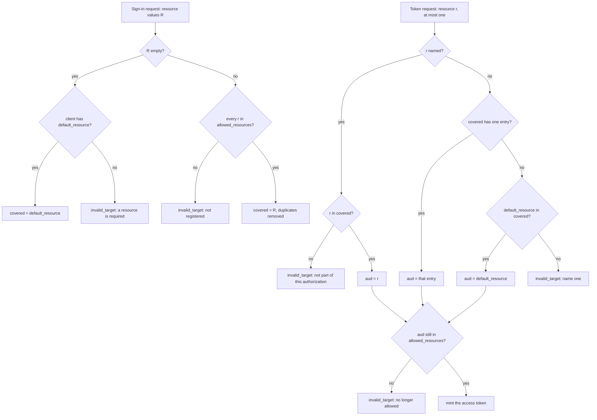

# Audience scoping — which API a token opens

> Companion to [authorize-code-flow.md](authorize-code-flow.md),
> [auth-flows.md](auth-flows.md) and [legacy-user-auth.md](legacy-user-auth.md), which specify the
> requests this parameter rides on, and to [admin-clients.md](admin-clients.md), which specifies
> the registry fields that gate it.

## Overview

Every access token names exactly one API in `aud`, and a resource server accepts only the tokens
named for it. A client chooses that API with the RFC 8707 `resource` parameter; a request that
names none gets the client's default resource. No access token is ever addressed to a client id.

One sign-in may cover several APIs. The client names them all when it signs in, and then takes one
access token per API from the same refresh token.

### Key design decisions

**One signing key means `aud` is the boundary, not the signature.** Every token this issuer mints
is signed with the same key, so a valid signature proves who minted a token and says nothing about
who it was minted for. A resource server that verifies the signature and the issuer but not the
audience accepts every other product's tokens.

**A sign-in may cover several resources; a token is for one.** RFC 8707 §2.1 lets an authorization
request repeat `resource`, and the whole grant then covers those resources. Each access token is
narrowed to one of them at the token endpoint (§2.2), so a token that leaks opens one API, which is
the audience restriction RFC 9700 §2.3 recommends. JWT allows `aud` to be an array; this issuer
never mints one.

**No resource means the client's default, and no default means a refusal.** RFC 9068 §3 requires a
default resource when the request names none. Each client has at most one, `default_resource`. A
client without one must name a resource, and a request that does not is refused with
`invalid_target`, which RFC 8707 §2 allows. The client id is never used in its place: it names the
caller, not an API, so no resource server accepts it.

**Absent registration means no resource may be requested, never any.** A client with no
`allowed_resources` may name none, and with no default it cannot get an access token at all.

**The resources are settled before the user is sent anywhere.** An unregistered resource is refused
at the authorize request, not at the code exchange, so nobody completes a whole login for a request
that was never valid.

**Exact string equality.** A resource is matched literally, like a redirect URI and for the same
reason: a prefix rule is an opening, and a normalisation rule is a second implementation to disagree
with the first.

**A refresh can narrow, never widen.** The resources a sign-in covers are stored on its refresh
family. A refresh may pick one of them, never add another, and every renewal re-checks the client's
registry entry, so withdrawing a resource also stops renewals already in flight.

## Pre-requisites

The client's registry row lists every resource it may request in `allowed_resources`, and
optionally one of them as `default_resource`. See [admin-clients.md](admin-clients.md) for the
rules.

## Design

### Two rules



**What a sign-in covers** is decided once, when it starts, and stored on the login flow and then on
the refresh family. **What one token is for** is decided at every mint.

### Where the parameter is accepted

| Request | `resource` | Behaviour |
|---|---|---|
| `GET /oauth2/authorize` | repeatable | Decides what the sign-in covers. A refusal redirects to the client with `invalid_target` |
| `POST /oauth2/token`, `authorization_code` | at most one | Picks the access token's resource from what the sign-in covers. The refresh family keeps all of them |
| `POST /oauth2/token`, `refresh_token` | at most one | Picks the renewed access token's resource from the family's |
| `POST /oauth2/token`, `client_credentials` | at most one | The request is the whole grant: the one named, else the client's default |
| `POST /v1/user/auth/token` (password sign-in) | not accepted | The sign-in covers every resource the password client is granted; the access token is for its default |
| `POST /v1/user/auth/token/refresh` | at most one, a JSON string | As the `refresh_token` grant |

An empty `resource` value is treated as omitted at each of these, as RFC 6749 §3.1 and §3.2 require
of any parameter sent without a value.

### Getting a token for each of two APIs

```
GET  /oauth2/authorize?...&resource=https://api.example.com&resource=https://account.example.com
POST /oauth2/token  grant_type=authorization_code ...                          -> aud https://api.example.com (the default) + refresh token
POST /oauth2/token  grant_type=refresh_token ... resource=https://account.example.com -> aud https://account.example.com + rotated refresh token
```

Each refresh rotates the refresh token, so a client refreshes one request at a time: two concurrent
refreshes with the same token read as reuse and revoke the family.

### What the caller receives

| Situation | Result |
|---|---|
| a covered resource named | an access token with that `aud` |
| none named, one covered | an access token for that one |
| none named, several covered, the default among them | an access token for the default |
| none named, several covered, no default among them | `invalid_target` |
| an uncovered or unregistered resource named | `invalid_target` |
| two `resource` values on a token request | `invalid_target` |
| a refresh family that recorded no resources | `invalid_grant`; the client signs in again |

The id token is unaffected. Its audience is the client, by OpenID Connect Core definition: it
identifies the user to the application that asked, and is not a credential for a resource server.

### Errors

| Condition | Response |
|---|---|
| A refusal at `/oauth2/authorize` | Redirect to the client with `error=invalid_target`. The redirect URI has already been validated, so returning the error to the client is safe |
| A refusal at `/oauth2/token` | `400`, `error=invalid_target`, and one of these descriptions: `This client is not registered for the requested resource.` · `A resource is required: this client has no default resource.` · `Only one resource may be requested; a token is never issued for two audiences.` · `The requested resource is not part of this authorization.` · `This authorization covers several resources; name one with the resource parameter.` · `This login was issued for a resource the client may no longer request. Start a new authorization.` |
| A refusal at `/v1/user/auth/*` | `400` with the same description as `message` |

A refused code exchange or refresh does not spend the code or the refresh token, so the client can
correct the request and retry.

## What a resource server must check

Verifying the signature and the issuer is not enough, because every product's tokens carry both. A
resource server accepts a token only when, in this order:

1. the algorithm is the one expected and the key is named by `kid`, taken from the issuer's
   published key document rather than from the token;
2. the signature verifies against that key;
3. `iss` is this issuer;
4. **`aud` names this API** — an absent audience fails closed and is never read as "addressed to
   everyone";
5. `exp` and `nbf` place it inside its window;
6. the token is an access token and not an id token;
7. `sub` is present.

Scope is deliberately not part of that list. Which scope a request needs is a property of the route,
so it is asked of the verified caller by whoever knows the route.

### The audiences this deployment's APIs accept

Each API's names are discovered from API Gateway at every deploy, never configured: its
execute-api URL and, once a custom domain is mapped, the domain's URL including any base path. The
execute-api name stays accepted after a domain is mapped, so tokens minted before it keep working.
A Lambda behind API Gateway takes these names from the request it is serving: the execute-api URL
from the API id and stage, and the custom domain and base path the request came in on. The Alexa
and SmartThings skills are invoked without a request, so their stacks pass `RmngApiAudiences` in
`ACCEPTED_AUDIENCES`; the MCP server's own construct does the same with `McpAudiences`. A Lambda
with no names refuses every access token.

| API | Accepts (`…Audiences` output) | Clients request (`…Resource` output) |
|---|---|---|
| neo REST API, and the Alexa, Google Home and SmartThings skills that act on its data | `RmngApiAudiences` (rmng-base) | `RmngApiResource` |
| MCP server (`/v1/mcp`) | `McpAudiences` (rmng-core) | `McpResource`, which the MCP OAuth proxy requests itself |
| ESP User API's own endpoints: `/v1/users/*`, `/v1/user/sessions`, `/v1/user/connected-apps`, `/oauth2/userinfo`, `/v1/user/auth/password` | any of this issuer's user access tokens | `EspUserApiResource` (optional) |

### The authorization server's own endpoints do not check `aud`

`aud` tells a **resource server** whether a token was minted for it (RFC 9068 §4, RFC 8707): neo, the
MCP server and the assistants each refuse a token for another API. The ESP User API is the
**authorization server**, not one product's resource server, so none of its endpoints check `aud`:

- **Standard OAuth and OIDC endpoints never take an access token as their credential.**
  `/oauth2/authorize` runs in the browser and signs the person in; `/oauth2/token` authenticates the
  client and a code, refresh token or client credentials (RFC 6749 §3.2); `/oauth2/revoke`
  authenticates the client (RFC 7009); `/oauth2/logout` runs in the browser; `/.well-known/*` is public.
  The legacy `/v1/user/auth/token`, `/refresh`, `/signup` and `/password-recovery` take a password,
  a refresh token or a code.
- **`/oauth2/userinfo` takes the access token the sign-in returned, whatever API it is for** (OIDC
  Core §5.3.1). Requiring its own `aud` would break standard OIDC client libraries, or make every app
  fetch a third token just for userinfo.
- **The account endpoints (`/v1/users/*`, `/v1/user/sessions`, `/v1/user/connected-apps`) and the legacy password change serve
  the signed-in account, not one API.** An app holds a token for the API it mostly calls, usually neo;
  requiring an ESP User API token as well would add a second token and a refresh to every app just
  to read its own profile.

Every one of these endpoints that takes an access token still verifies it fully: our signature
(RS256, a `kid` from our JWKS), `iss`, `exp`, `token_use = access`, and that it is a person's token
rather than a `client_credentials` one. Only the "which API is it for" step is left out.

What each endpoint accepts instead of an `aud` match:

| Endpoint | Takes a user access token from | Gate |
|---|---|---|
| `/oauth2/userinfo` | any client, first-party or not | none: it returns only the scope-gated claims already in the token |
| `/v1/users/*` | **first-party clients only** | the client's registry row has `first_party = true`, read on every call; otherwise 403 `access_denied` |
| `/v1/user/sessions`, `/v1/user/connected-apps` | **first-party clients only** | `first_party = true` and the `account:sessions` scope; otherwise 403 |
| `/v1/user/auth/password` | any client | the old password, which is what authorizes the change |

**Why first-party.** Without an `aud` match, a token handed to a third party (Alexa, Google Home,
SmartThings, an MCP client) would otherwise open the account: read the email and phone at
`/v1/users/me`, list the person's devices, sign them out of other devices. First-party clients are
the apps we ship, registered with `first_party = true` (espuser-base seeds `rainmaker-neo-home-app-client` that
way; an admin sets it on the others through the clients API); the flag lives on the client's registry row rather than in a token claim or an env var, so taking a client's
standing away applies to its next call, not when its tokens expire. Scopes will replace this gate:
an account scope per endpoint, granted at consent, will let a third party in only where the person
allowed it.

The stack that creates each API also adds every name in its `…Audiences` to the seeded clients that
call it, right after discovering it, with its `…Resource` as the default: `rainmaker-neo-home-app-client` gets neo's (its default) and
ESP User's; `mcp-oauth-client` gets the MCP server's. Each voice assistant's stack gives its own client
(`rainmaker-neo-alexa-client`, `rainmaker-neo-gva-client`, `rainmaker-neo-smartthings-client`) neo's names when it creates it. A name is
only ever added, and a default is set only on a client that has none, so an operator's own entries
survive every deploy. See
[admin-clients.md](admin-clients.md#seeding-the-current-clients-deploy-time).

## Security analysis

| Concern | What stands in the way |
|---|---|
| A token minted for one product accepted by another | `aud` names the callee, and each resource API checks it; the ESP User API's account endpoints take any of ours, but only from first-party clients |
| A token addressed to nobody in particular | No access token is minted without a resource; a client id is never an audience |
| A client minting a token for an API it has no business calling | `allowed_resources`, checked before the login begins and again at every mint |
| One leaked credential good at several APIs | A sign-in may cover several, but each access token is for one |
| A refresh widening what a login opens | A refresh can only pick among the resources the sign-in covered |
| A withdrawn entitlement living on in a long login | Every renewal re-checks the client's `allowed_resources` |

## Known limitations

- **Resource values are compared literally.** `https://api.example.com` and
  `https://api.example.com/` are different resources. A deployment must use one spelling in the
  registry and in every client.
- **Profile claims ride the access token.** Scope-gated contact claims are stamped on the access
  token as well as the id token, so a resource server named in `aud` receives them whether or not
  it asked.
- **Refreshes are sequential per family.** A client holding one refresh token for several APIs
  must not refresh two of them concurrently.

## FAQs

**Why not put several audiences in one token?** Because the value of the parameter is that a leaked
credential opens one thing. A client that needs two APIs signs in once for both and takes one token
per API from the same refresh token.

**What happens when no resource is sent?** The client's default resource is used, as RFC 9068 §3
requires. A client with no default is refused with `invalid_target` and must name one.

**A token verifies perfectly and my API still rejects it.** That is the audience check working.
Compare the token's `aud` against the exact string the API expects; a token minted for another
product verifies flawlessly and is still not for you.
